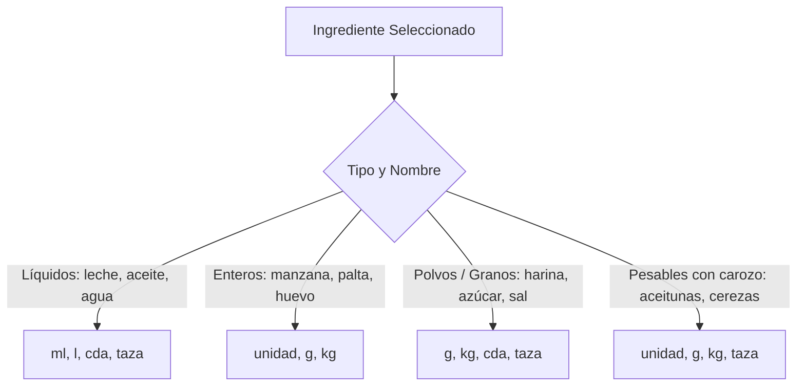
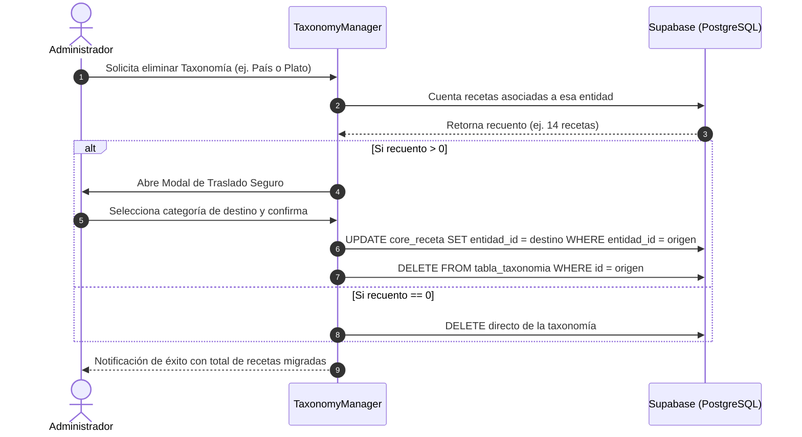

# 📖 Documentación Técnica: Sistema de Recetas, Taxonomías y Editor Culinario
## ChileBite — Modernización de Componentes, Unidades Inteligentes y Gestión Administrativa

**Documento:** Memoria de Cambios Funcionales, Arquitectura y Experiencia de Usuario  
**Módulos Afectados:**  
- `shared/utils/unitRules.js`  
- `features/recipes/components/IngredientSelector.jsx`  
- `features/recipes/components/RecipeDetail.jsx`  
- `features/recipes/components/RecipeEditor.jsx`  
- `features/admin/components/TaxonomyManager.jsx`  
- `features/admin/components/IngredientManager.jsx`  
- `shared/ui/AffiliateCarousel.jsx`  
- `styles/global.css`  
**Versión:** 1.2.0  
**Fecha:** Octubre 2026  

---

## 📑 Tabla de Contenidos
1. [Resumen Ejecutivo y Alcance](#1-resumen-ejecutivo-y-alcance)
2. [Motor de Unidades Inteligentes y Escalado Culinario Natural](#2-motor-de-unidades-inteligentes-y-escalado-culinario-natural)
   - 2.1 Validación Contextual de Unidades por Ingrediente
   - 2.2 Conversión Gramatical y Humana al Escalar Porciones
3. [Carrusel de Afiliados y Navegación Culinaria](#3-carrusel-de-afiliados-y-navegación-culinaria)
   - 3.1 Corrección Matemática del Bucle Infinito
   - 3.2 Enlace Ancla desde los Pasos de Preparación
4. [Gestor de Taxonomías y Prevención de Recetas Huérfanas](#4-gestor-de-taxonomías-y-prevención-de-recetas-huérfanas)
   - 4.1 Contenedores Independientes con Scroll Propio
   - 4.2 Flujo de Eliminación Asistida con Traslado de Categoría
5. [Estudio y Editor de Recetas (RecipeEditor)](#5-estudio-y-editor-de-recetas-recipeeditor)
   - 5.1 Reorganización en 4 Bloques Temáticos
   - 5.2 Simplificación: Porción Base por Defecto (1 Persona)
   - 5.3 Supresión Global de Flechas Numéricas (Spinners)
   - 5.4 Modal Interactivo de Guardado y Cierre Controlado
6. [Arquitectura de Notificaciones y Corrección en HeroUI v3](#6-arquitectura-de-notificaciones-y-corrección-en-heroui-v3)
   - 6.1 Problema de Objetos como React Children
   - 6.2 Conflicto de Proveedores Duplicados y View Transitions
7. [Matriz de Archivos Modificados y Verificación](#7-matriz-de-archivos-modificados-y-verificación)

---

## 1. Resumen Ejecutivo y Alcance

Durante esta actualización se ejecutó una reingeniería profunda sobre las áreas críticas de experiencia de usuario (UX), precisión culinaria y administración de catálogo de ChileBite:

1. **Precisión Semántica en Cocina:** Se resolvió el problema de unidades ilógicas (evitando cucharadas de manzanas o aceitunas) y se añadió formato de lenguaje natural para ingredientes de alto gramaje (ej. *"1 kilo y 950 gramos"* en lugar de *"1950 g"*).
2. **Estabilidad Administrativa:** Las taxonomías (países, tipos de plato y estilos de vida) ahora cuentan con interfaz de scrolls independientes y un sistema de reasignación que impide que recetas queden huérfanas al borrar una categoría.
3. **Ergonomía en el Estudio de Recetas:** Se ordenó el editor en 4 bloques temáticos, se removió el campo redundante de porciones base (fijado a 1), se suprimieron las flechas nativas del navegador en inputs numéricos y se dotó al usuario de un modal de confirmación con opciones de cierre y permanencia.
4. **Depuración de Arquitectura Frontend:** Se armonizó el sistema de toasts de `@heroui/react` eliminando instancias duplicadas y adaptando firmas de métodos para evitar caídas de React en tiempo de ejecución.

---

## 2. Motor de Unidades Inteligentes y Escalado Culinario Natural

### 2.1 Validación Contextual de Unidades por Ingrediente
Anteriormente, el selector permitía elegir cualquier unidad de medida para cualquier ingrediente (por ejemplo, *cucharadas de manzana*, *tazas de aceitunas enteras* o *unidades de harina*).

Se desarrolló el módulo [`unitRules.js`](file:///c:/Users/chrys/Documents/Github/ChileBite/ChileBiteFront/Recetas/src/features/recipes/utils/unitRules.js) que clasifica los ingredientes por su naturaleza física:



* **Reglas específicas:**
  - Frutas y verduras de pieza grande (`manzana`, `pera`, `naranja`, `zapallo`): Se deshabilitan `cucharada` y `cucharadita`. Se permite `unidad`, `g` o `kg`.
  - Aceitunas y frutas pequeñas: Se permite `unidad`, `g`, `kg` o `taza`, bloqueando `cucharada`.
  - Harinas y polvos: Se bloquea `unidad` para evitar "1 unidad de harina".

### 2.2 Conversión Gramatical y Humana al Escalar Porciones
En la ficha técnica de la receta ([`RecipeDetail.jsx`](file:///c:/Users/chrys/Documents/Github/ChileBite/ChileBiteFront/Recetas/src/features/recipes/components/RecipeDetail.jsx)), cuando el usuario incrementa las porciones (ej. de 1 a 6 personas), una cantidad de `325 g` de zapallo multiplicada por 6 resultaba en `1950 g`.

La función `formatIngredientQuantityHuman(cantidadGramos, ingredienteNombre, unidad)` convierte estas cantidades a redacción cotidiana:
* `1000 g` $\rightarrow$ `"1 kilo"`
* `1950 g` $\rightarrow$ `"1 kilo y 950 gramos"`
* `2000 g` $\rightarrow$ `"2 kilos"`
* `2500 g` $\rightarrow$ `"2 kilos y medio"`

Esto eleva la naturalidad de la receta y facilita las compras en ferias y supermercados chilenos.

---

## 3. Carrusel de Afiliados y Navegación Culinaria

### 3.1 Corrección Matemática del Bucle Infinito
En [`AffiliateCarousel.jsx`](file:///c:/Users/chrys/Documents/Github/ChileBite/ChileBiteFront/Recetas/src/shared/ui/AffiliateCarousel.jsx), el carrusel de productos culinarios presentaba un salto brusco hacia espacios vacíos tras unos segundos.

* **Causa detectada:** El arreglo de productos se duplicaba a 2 copias (`[...items, ...items]`), pero la condición de reseteo del scroll en `requestAnimationFrame` evaluaba `TOTAL_WIDTH_SINGLE * 3`, desfasando el límite visible fuera del viewport.
* **Solución aplicada:** Se estructuró un buffer de 3 copias consecutivas y un reset modular exacto:
  ```javascript
  if (container.scrollLeft >= totalSingleWidth) {
    container.scrollLeft -= totalSingleWidth;
  }
  ```
  Garantizando desplazamiento continuo a 60 FPS sin parpadeos ni saltos.

### 3.2 Enlace Ancla desde los Pasos de Preparación
Al final de la preparación en [`RecipeDetail.jsx`](file:///c:/Users/chrys/Documents/Github/ChileBite/ChileBiteFront/Recetas/src/features/recipes/components/RecipeDetail.jsx), se incorporó un botón flotante:
* **"Equipa tu Cocina para esta Receta"**: Realiza un scroll suave hacia el contenedor `#productos-cocina`, conectando la lectura del paso a paso con las recomendaciones de utensilios y ollas recomendadas.

---

## 4. Gestor de Taxonomías y Prevención de Recetas Huérfanas

En [`TaxonomyManager.jsx`](file:///c:/Users/chrys/Documents/Github/ChileBite/ChileBiteFront/Recetas/src/features/admin/components/TaxonomyManager.jsx), se rediseñó por completo el panel de administración de metadatos:

### 4.1 Contenedores Independientes con Scroll Propio
* Las 3 columnas (Países, Tipos de Plato, Estilos de Vida) ahora cuentan con alturas fijas máximas (`max-h-[420px]`) y scrollbars estilizadas (`custom-scrollbar`).
* Cada categoría posee su propia caja de búsqueda en tiempo real, permitiendo encontrar rápidamente registros entre listas extensas sin afectar la visibilidad de las demás secciones.

### 4.2 Flujo de Eliminación Asistida con Traslado de Categoría
Borrar una categoría en un sistema relacional solía dejar recetas con campos `null` o desasociadas.



* **Garantía:** Ninguna receta queda vacía o en estado huérfano.

---

## 5. Estudio y Editor de Recetas (RecipeEditor)

[`RecipeEditor.jsx`](file:///c:/Users/chrys/Documents/Github/ChileBite/ChileBiteFront/Recetas/src/features/recipes/components/RecipeEditor.jsx) fue reestructurado tanto estética como funcionalmente:

### 5.1 Reorganización en 4 Bloques Temáticos
1. **Bloque 1 — Identidad y Clasificación:** Nombre de la receta, bajada breve, historia detallada, país de origen, tipo de plato, tiempo total, nivel de dificultad y estilos de vida (Vegano, Celíaco, etc.).
2. **Bloque 2 — Multimedia y Portada:** Carga de imagen principal, selector inteligente de plataforma de video (YouTube estándar, YouTube Shorts, TikTok) con previsualización responsive.
3. **Bloque 3 — Ingredientes y Nutrición en Vivo:** Buscador reactivo integrado con `IngredientSelector`, badges calóricos y cálculo automático en tiempo real de macronutrientes totales (kcal, proteínas, carbohidratos, grasas).
4. **Bloque 4 — Paso a Paso y Consejos del Chef:** Editor de pasos dinámicos (añadir, reordenar, eliminar) y campo dedicado para consejos del chef y sustitutos culinarios.

### 5.2 Simplificación: Porción Base por Defecto (1 Persona)
* Se eliminó el campo y selector interactivo de "Porciones Base" del formulario, respondiendo al requerimiento del negocio donde toda receta se formula de forma estandarizada para 1 comensal.
* En el payload enviado a Supabase, `numero_porcion` se establece fijamente en `1`, permitiendo que el motor de escalado en la vista pública multiplique las porciones de manera matemática limpia ($1 \times N$).

### 5.3 Supresión Global de Flechas Numéricas (Spinners)
Para evitar que los inputs numéricos del navegador (como el de minutos de preparación) muestren flechas nativas `▲▼` superpuestas o desalineadas con los botones `−` y `+`:
* En [`global.css`](file:///c:/Users/chrys/Documents/Github/ChileBite/ChileBiteFront/Recetas/src/styles/global.css):
  ```css
  input[type="number"]::-webkit-outer-spin-button,
  input[type="number"]::-webkit-inner-spin-button {
    -webkit-appearance: none;
    margin: 0;
  }
  input[type="number"] {
    -moz-appearance: textfield;
    appearance: textfield;
  }
  ```
* En las clases de Tailwind de los inputs numéricos:
  `[appearance:textfield] [&::-webkit-outer-spin-button]:appearance-none [&::-webkit-inner-spin-button]:appearance-none`

### 5.4 Modal Interactivo de Guardado y Cierre Controlado
Se sustituyó la redirección automática forzada (`setTimeout` de 2.5s) por un **modal flotante de éxito**:
* Permite al usuario cerrar la notificación en cualquier momento (`X` o clic fuera).
* Opción **"Seguir Editando"**: Mantiene al creador en la pantalla para continuar haciendo retoques.
* Opción **"Ir al Recetario"**: Redirecciona a `/recipes`.
* Opción **"Ver Receta"**: Abre directamente la receta pública creada o editada (`/recipes/:id`).

---

## 6. Arquitectura de Notificaciones y Corrección en HeroUI v3

### 6.1 Problema de Objetos como React Children
En `@heroui/react` versión 3 (`v3.0.0-rc.1`), la función `toast` recibe una cadena de texto como primer parámetro:
$$\text{toast}(message, options)$$

Llamadas previas que invocaban `addToast({ title, description, color })` pasaban el objeto literal como primer argumento. El renderizador interno de HeroUI colocaba ese objeto dentro de un elemento `<span>`, detonando la excepción fatal de React:
> `Objects are not valid as a React child (found: object with keys {title, description, color, timeout})`

* **Solución aplicada:** Se implementó un adaptador normalizador en `RecipeEditor.jsx`:
  ```javascript
  const addToast = ({ title, description, color = 'default', timeout = 3500 }) => {
    const message = title || description || '';
    const options = {
      description: title && description ? description : undefined,
      timeout
    };
    if (color === 'danger' || color === 'error') {
      toast.danger(message, options);
    } else if (color === 'success') {
      toast.success(message, options);
    } else {
      toast(message, options);
    }
  };
  ```

### 6.2 Conflicto de Proveedores Duplicados y View Transitions
El componente de barra superior [`Navbar.jsx`](file:///c:/Users/chrys/Documents/Github/ChileBite/ChileBiteFront/Recetas/src/shared/layout/Navbar.jsx) ya aloja de forma persistente y global un `<Toast.Provider placement="bottom end" />`.

Cuando las vistas hijas (`RecipeEditor`, `TaxonomyManager`, `IngredientManager`) montaban su propio `<ToastProvider>`, se producían dos errores en cascada:
1. **Accesibilidad ARIA duplicada:** `Page contains more than one landmark with the 'region' role and '1 notificación.' label`.
2. **Colisión de animaciones nativas:** Ambos proveedores reaccionaban al mismo evento del `toastQueue` e intentaban crear transiciones con el mismo identificador:
   > `Unexpected duplicate view-transition-name: toast--... Uncaught (in promise) InvalidStateError`

* **Solución aplicada:** Se eliminaron los `<ToastProvider>` redundantes en las páginas hijas, dejando al proveedor global de `Navbar.jsx` como despachador único y centralizado de todas las alertas.

---

## 7. Matriz de Archivos Modificados y Verificación

| Archivo | Tipo de Intervención | Impacto Principal |
| :--- | :--- | :--- |
| [`unitRules.js`](file:///c:/Users/chrys/Documents/Github/ChileBite/ChileBiteFront/Recetas/src/features/recipes/utils/unitRules.js) | Creación | Reglas de unidades permitidas y formateador gramatical humano de porciones. |
| [`RecipeDetail.jsx`](file:///c:/Users/chrys/Documents/Github/ChileBite/ChileBiteFront/Recetas/src/features/recipes/components/RecipeDetail.jsx) | Modificación | Escalado natural de unidades ($> 1000\text{g} \rightarrow \text{kilos}$) y botón ancla a productos. |
| [`AffiliateCarousel.jsx`](file:///c:/Users/chrys/Documents/Github/ChileBite/ChileBiteFront/Recetas/src/shared/ui/AffiliateCarousel.jsx) | Modificación | Bucle infinito 100% continuo sin parpadeos ni huecos en blanco. |
| [`TaxonomyManager.jsx`](file:///c:/Users/chrys/Documents/Github/ChileBite/ChileBiteFront/Recetas/src/features/admin/components/TaxonomyManager.jsx) | Modificación | Scrollbars independientes, filtros reactivos y migración segura de recetas asociadas. |
| [`RecipeEditor.jsx`](file:///c:/Users/chrys/Documents/Github/ChileBite/ChileBiteFront/Recetas/src/features/recipes/components/RecipeEditor.jsx) | Modificación | 4 bloques temáticos, porción base en 1, inputs sin spinners, modal interactivo de guardado. |
| [`IngredientManager.jsx`](file:///c:/Users/chrys/Documents/Github/ChileBite/ChileBiteFront/Recetas/src/features/admin/components/IngredientManager.jsx) | Modificación | Eliminación de ToastProvider redundante. |
| [`global.css`](file:///c:/Users/chrys/Documents/Github/ChileBite/ChileBiteFront/Recetas/src/styles/global.css) | Modificación | Ocultamiento global de spin buttons nativos en `input[type="number"]`. |

### Resultado de Compilación
* Comando ejecutado: `npm run build`
* Resultado: **Completado con Código de Salida 0 (Exit code: 0)**
* Rutas prerenderizadas correctamente, cero conflictos de tipos y compatibilidad total con SSR.
