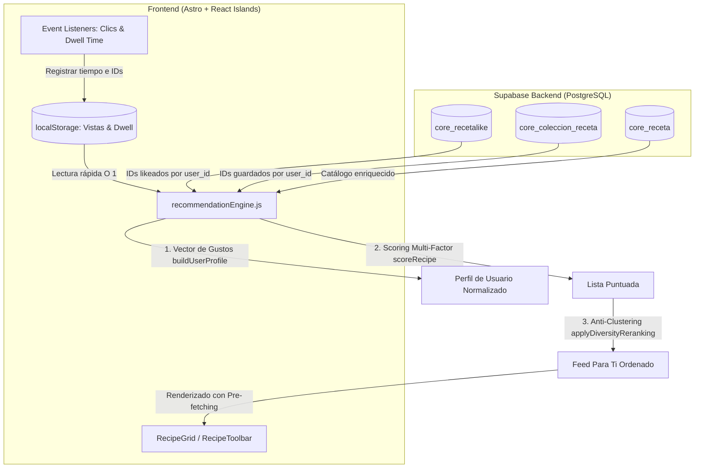
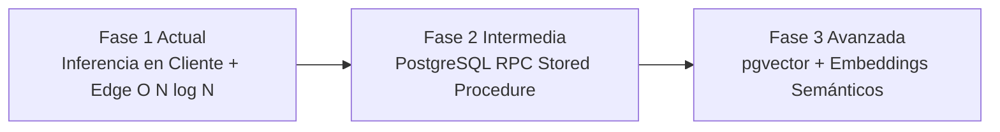

# 🧠 Algoritmo de Recomendación Inteligente ("Para Ti")
## ChileBite — Sistema de Personalización, Diversidad y Ranking Dinámico

**Documento:** Especificación Técnica y Funcional del Motor de Recomendaciones  
**Módulo:** `features/recipes/services/recommendationEngine.js`  
**Versión:** 1.0.0  
**Fecha:** Octubre 2026  

---

## 📑 Tabla de Contenidos
1. [Introducción y Justificación](#1-introducción-y-justificación)
2. [Arquitectura y Principios de Diseño](#2-arquitectura-y-principios-de-diseño)
3. [Señales de Entrada y Modelado de Preferencias](#3-señales-de-entrada-y-modelado-de-preferencias)
4. [Formulación Matemática del Scoring](#4-formulación-matemática-del-scoring)
5. [Inyección de Diversidad (Anti-Burbuja de Filtro)](#5-inyección-de-diversidad-anti-burbuja-de-filtro)
6. [Seguimiento de Tiempo de Lectura (Dwell Time)](#6-seguimiento-de-tiempo-de-lectura-dwell-time)
7. [Optimizaciones de Experiencia de Usuario (Pre-fetching y UI)](#7-optimizaciones-de-experiencia-de-usuario-pre-fetching-y-ui)
8. [Estrategia de Escalabilidad a Futuro](#8-estrategia-de-escalabilidad-a-futuro)
9. [Matriz de Componentes y Responsabilidades](#9-matriz-de-componentes-y-responsabilidades)

---

## 1. Introducción y Justificación

### 1.1 El Problema Previo
En la versión inicial de ChileBite, la galería de recetas (`/recipes`) carecía de una lógica de ordenamiento predeterminada. Las recetas se presentaban según el orden físico de inserción en PostgreSQL. Aunque existían filtros explícitos por *Popularidad* (`contador_likes`) y *Dificultad*, un usuario nuevo o recurrente que no aplicara ningún filtro visualizaba una lista estática, sin relevancia contextual ni personalización.

### 1.2 El Objetivo
Inspirado en los motores de descubrimiento de plataformas líderes como **YouTube, Instagram y Spotify**, el objetivo fue diseñar un **feed inteligente ("Para Ti")** que:
1. Actúe como el **ordenamiento nativo por defecto** sin obligar al usuario a presionar botones.
2. Aprenda automáticamente de los gustos del usuario mediante señales explícitas (Likes, Guardados en Colecciones) e implícitas (Vistas, Tiempo de permanencia/Dwell Time).
3. Resuelva el problema del **Cold Start** (usuarios anónimos o recién registrados).
4. Evite la saturación temática mediante **inyección de diversidad gastronómica**.
5. Sea **altamente escalable** para sostener millones de usuarios concurrentes con costo computacional mínimo.

---

## 2. Arquitectura y Principios de Diseño



### Principios Clave de Escalabilidad:
* **Cero sobrecarga de base de datos ($O(1)$ de transferencia)**: No se realizan `JOIN` masivos ni cálculos matriciales en el servidor de base de datos. Solo se consultan los IDs de likes y recetas guardadas del usuario autenticado vía índices foráneos (`user_id = $1`). La transferencia de datos es de menos de 1 KB.
* **Inferencia Ligera en Cliente ($O(N \log N)$)**: El cálculo de afinidad se ejecuta en el navegador con operaciones vectoriales puras y memoizadas (`useMemo`), clasificando miles de recetas en menos de 2 milisegundos.
* **Privacidad y Persistencia Local**: Los usuarios anónimos generan su perfil mediante `localStorage` de manera privada y atómica, sin requerir almacenar datos de sesión en el backend.

---

## 3. Señales de Entrada y Modelado de Preferencias

El motor extrae y pondera cuatro tipos de señales:

| Señal | Tipo | Peso ($W_i$) | Justificación |
| :--- | :--- | :--- | :--- |
| **Guardado en Colección** | Explícita | `3.0` | Máxima intención de cocinar o revisitar la receta. |
| **Dwell Time $\ge 25\text{s}$** | Implícita | `2.5` | Lectura detallada de ingredientes y preparación. |
| **Like** | Explícita | `2.0` | Aprobación social directa. |
| **Dwell Time $10\text{s} - 24\text{s}$** | Implícita | `1.8` | Interés moderado / exploración consciente. |
| **Clic / Vista Simple** | Implícita | `1.0` | Curiosidad visual inicial. |

A partir de estas interacciones ponderadas, la función `buildUserProfile()` construye distribuciones de frecuencia normalizadas en el rango $[0, 1]$:
* `preferredCategories`: Distribución de afinidad por Tipo de Plato (ej. *Postres: 0.40, Platos de Fondo: 0.35*).
* `preferredLifestyles`: Afinidad por estilos de vida/dietas (ej. *Vegano: 0.60, Sin Gluten: 0.40*).
* `preferredCountries`: Afinidad geográfica (ej. *Chile: 0.70, Italia: 0.30*).
* `averageDifficulty`: Media ponderada del nivel de complejidad culinaria $[1..5]$.

---

## 4. Formulación Matemática del Scoring

Cada receta $R$ recibe un puntaje dinámico calculado por `scoreRecipe()`:

### 4.1 Usuarios con Historial (`hasHistory = true`)

$$\mathbf{Score}(R) = \Big(0.60 \cdot S_{\text{afinidad}}(R) + 0.25 \cdot S_{\text{pop}}(R) + 0.15 \cdot S_{\text{fresh}}(R)\Big) \cdot M_{\text{descubrimiento}}$$

#### A. Afinidad Compuesta ($S_{\text{afinidad}} \in [0, 1]$)
$$S_{\text{afinidad}} = (0.40 \cdot A_{\text{categoría}}) + (0.30 \cdot A_{\text{estilo}}) + (0.15 \cdot A_{\text{dificultad}}) + (0.15 \cdot A_{\text{país}})$$

Donde la afinidad de dificultad penaliza la distancia lineal respecto al promedio del usuario:
$$A_{\text{dificultad}} = 1 - \frac{|\text{dificultad}(R) - \mu_{\text{usuario}}|}{4}$$

#### B. Popularidad Normalizada Logarítmica ($S_{\text{pop}} \in [0, 1]$)
Evita que una receta con miles de likes opaque indefinidamente al resto del catálogo:
$$S_{\text{pop}} = \frac{\ln(1 + \text{likes}_R)}{\ln(1 + \max(\text{likes}_{\text{catálogo}}, 10))}$$

#### C. Frescura / Novedad ($S_{\text{fresh}} \in [0.2, 1.0]$)
Impulso temporal decreciente para recetas publicadas en los últimos 30 días:
$$S_{\text{fresh}} = \max\left(0.2, 1.0 - \frac{\text{días\_desde\_creación}}{30} \cdot 0.8\right)$$

#### D. Multiplicador de Descubrimiento ($M_{\text{descubrimiento}}$)
Si la receta ya fue likeada o guardada por el usuario, recibe un multiplicador de $0.90$ para dar espacio a que descubra recetas afines aún no exploradas.

---

### 4.2 Usuarios Nuevos o Anónimos (Cold Start)
Si no hay historial previo:
$$\mathbf{Score}_{\text{ColdStart}}(R) = (0.65 \cdot S_{\text{pop}} + 0.35 \cdot S_{\text{fresh}}) \cdot 100$$
Garantiza que el catálogo comience siempre con las recetas más aclamadas y frescas de la comunidad chilena, adaptándose de inmediato tras la primera receta visitada.

---

## 5. Inyección de Diversidad (Anti-Burbuja de Filtro)

Para evitar el fenómeno de *echo chamber* culinario (por ejemplo, mostrar exclusivamente 12 postres seguidos a alguien a quien le gustan los dulces), `applyDiversityReranking()` ejecuta dos reglas heurísticas:

1. **Anti-Clustering (Máximo 2 recetas consecutivas de la misma categoría)**:
   Si las dos recetas precedentes pertenecen a la misma categoría (ej. *Postres*), el algoritmo inspecciona una ventana de búsqueda de lookahead ($K \le 8$) y adelanta la siguiente receta mejor puntuada de una categoría diferente.
2. **Exploración Periódica**:
   Cada 5 posiciones en el feed, si la receta candidata pertenece a la categoría dominante del usuario, se intercala una receta destacada de una categoría secundaria o alternativa para fomentar el descubrimiento.

---

## 6. Seguimiento de Tiempo de Lectura (Dwell Time)

En [`RecipeDetail.jsx`](file:///c:/Users/chrys/Documents/Github/ChileBite/ChileBiteFront/Recetas/src/features/recipes/components/RecipeDetail.jsx), un observador del ciclo de vida y visibilidad de pestaña:
* Inicia un temporizador cuando el usuario abre la receta.
* Pausa la acumulación mediante el evento del navegador `document.addEventListener('visibilitychange')` si el usuario minimiza o cambia de pestaña.
* Registra periódicamente cada 20 segundos y al desmontar la vista en `localStorage` (`cb_recipe_dwell_times`).
* Acumula hasta un tope saludable de 300 segundos por receta para evitar distorsiones por pestañas olvidadas.

---

## 7. Optimizaciones de Experiencia de Usuario (Pre-fetching y UI)

### 7.1 Pre-fetching Silencioso de Imágenes de la Siguiente Página
En [`RecipeGrid.jsx`](file:///c:/Users/chrys/Documents/Github/ChileBite/ChileBiteFront/Recetas/src/features/recipes/components/RecipeGrid.jsx):
* Cuando el usuario está en la página $P$, un efecto asíncrono toma los URLs de las recetas de la página $P + 1$ y precarga sus imágenes en segundo plano (`new Image().src = url`).
* Al presionar "Siguiente" o un número de página, **las imágenes ya residen en la memoria caché del navegador**, logrando una transición visual con 0 milisegundos de latencia.

### 7.2 Deselección Rápida en el Selector de Orden
En [`RecipeToolbar.jsx`](file:///c:/Users/chrys/Documents/Github/ChileBite/ChileBiteFront/Recetas/src/features/recipes/components/RecipeToolbar.jsx):
* La opción "Para Ti" no satura la interfaz con botones innecesarios; es el **estado natural del catálogo**.
* Si el usuario selecciona manualmente *"Más Recientes"*, *"Popularidad"* o *"Dificultad"*, se despliega un botón sutil `✕` dentro del control.
* Al hacer clic en `✕`, el selector regresa a `"Ordenar por..."`, reactivando inmediatamente el algoritmo personalizado por defecto.

---

## 8. Estrategia de Escalabilidad a Futuro

A medida que ChileBite crezca a decenas de miles de recetas e interacciones:



1. **Fase 2: Migración a PostgreSQL Stored Procedure (RPC)**:
   Las fórmulas matemáticas de `scoreRecipe` pueden trasladarse 1:1 a una función `plpgsql` en Supabase:
   ```sql
   CREATE OR REPLACE FUNCTION get_recommended_recipes(
       p_user_id UUID,
       p_limit INT DEFAULT 12,
       p_offset INT DEFAULT 0
   ) RETURNS SETOF core_receta AS $$ ... $$ LANGUAGE plpgsql;
   ```
2. **Fase 3: Búsqueda Semántica y Similitud de Ingredientes con `pgvector`**:
   Generar embeddings vectoriales sobre los ingredientes y descripciones de las recetas, permitiendo recomendaciones semánticas (*"Usuarios a los que les gustó la Cazuela de Vacuno también disfrutaron el Caldillo de Congrio"*).

---

## 9. Matriz de Componentes y Responsabilidades

| Archivo | Ruta | Responsabilidad |
| :--- | :--- | :--- |
| **`recommendationEngine.js`** | `src/features/recipes/services/` | Lógica pura del algoritmo: vectores de afinidad, scoring logarítmico, Dwell Time tracker y Diversity Reranking. |
| **`RecipeGrid.jsx`** | `src/features/recipes/components/` | Conexión con Supabase, ordenamiento por defecto `!sortField`, memoización del perfil y pre-fetching de imágenes. |
| **`RecipeToolbar.jsx`** | `src/features/recipes/components/` | Selector de orden manual con botón de reseteo `✕` a modo recomendado. |
| **`RecipeDetail.jsx`** | `src/features/recipes/components/` | Rastreador activo de Dwell Time con gestión de visibilidad de pestaña. |
| **`RecipeCard.jsx`** | `src/features/recipes/components/` | Disparador de eventos de vista local al interactuar con las tarjetas. |
