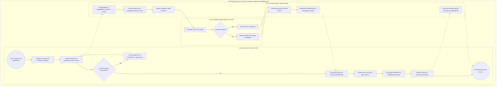
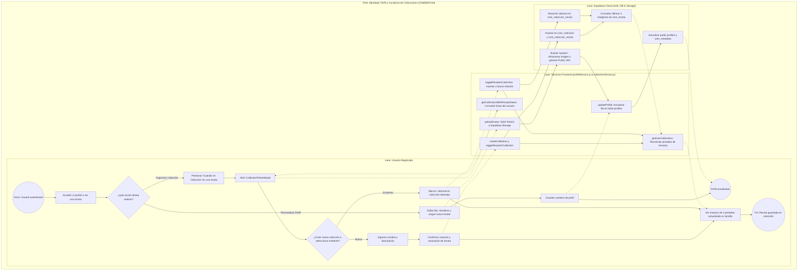
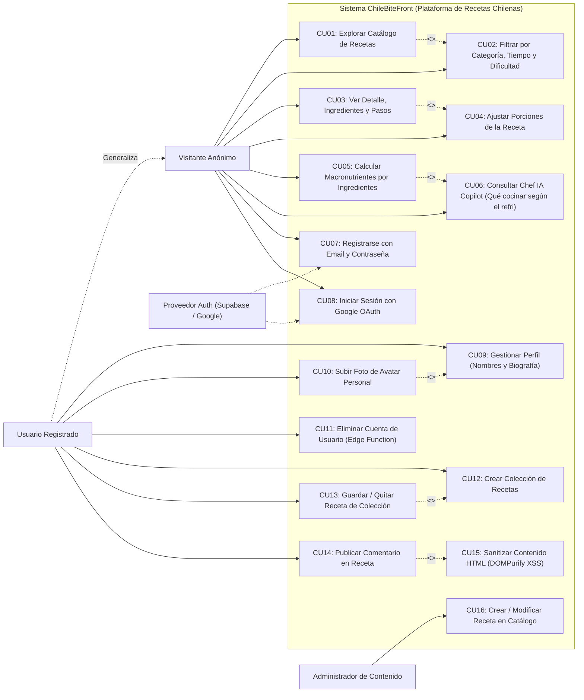
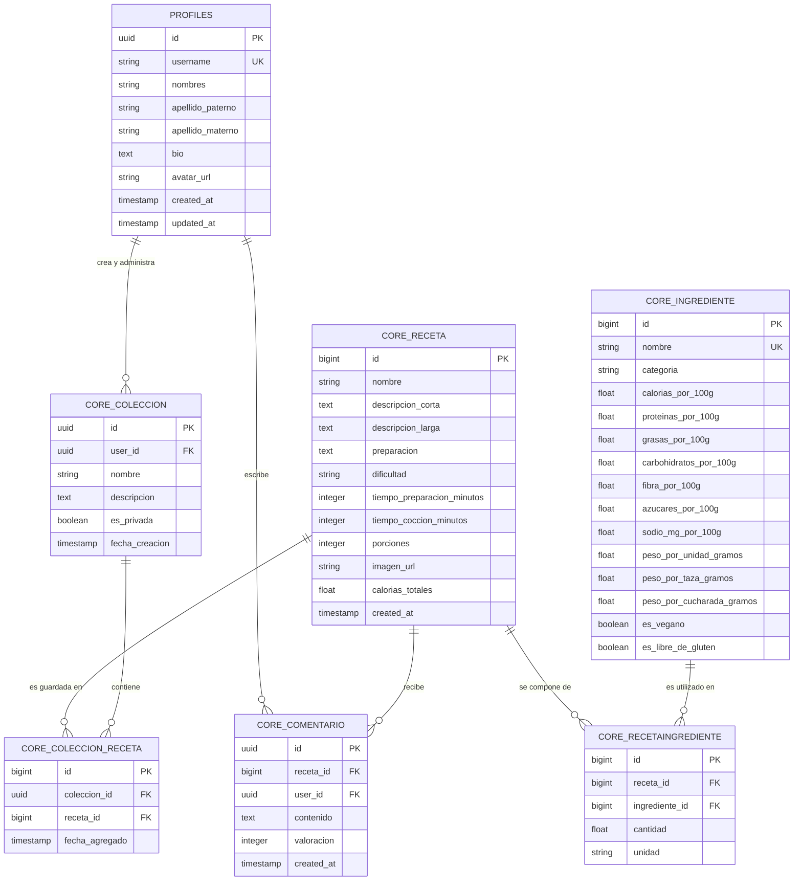
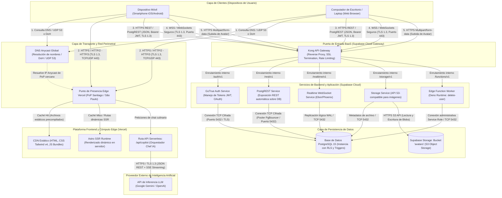
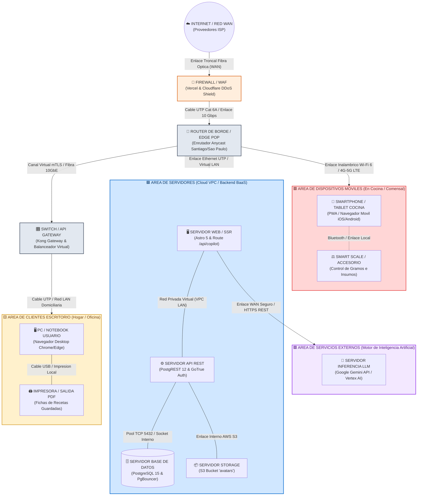
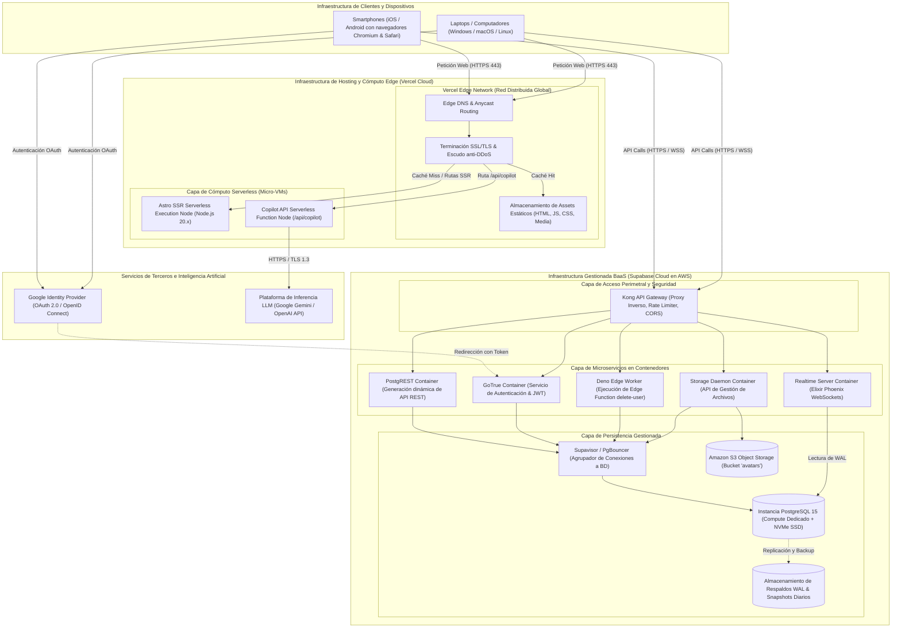
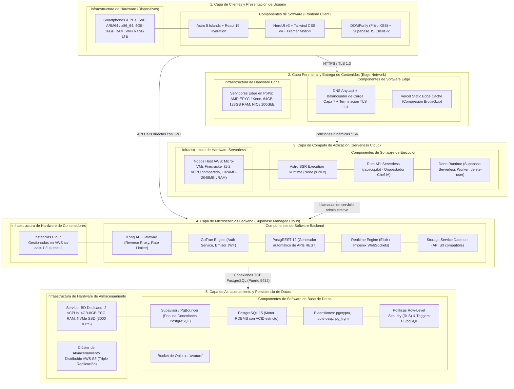

# 📘 Especificación Técnica y Descriptiva de Diagramas y Arquitectura
## ChileBiteFront — Plataforma Web Gastronómica y Nutricional

**Documento:** Memoria de Ingeniería de Software, Procesos, Modelo de Datos, Comunicaciones, Infraestructura y Arquitectura TI  
**Alcance:** Exclusivo para **ChileBiteFront** (Recetario Chileno, Calculadora de Macros e Ingredientes, Chef IA Copilot, Perfiles y Colecciones)  
**Versión:** 3.0.0  
**Fecha:** 2026-10-12  

---

## 📑 Tabla de Contenidos
1. [Diagrama 1: BPMN — Búsqueda, Filtrado y Visualización Detallada de Recetas](#1-diagrama-bpmn-1--búsqueda-filtrado-y-visualización-detallada-de-recetas)
2. [Diagrama 2: BPMN — Cálculo Nutricional por Ingredientes y Asistente Chef IA](#2-diagrama-bpmn-2--cálculo-nutricional-por-ingredientes-y-asistente-chef-ia)
3. [Diagrama 3: BPMN — Identidad, Perfil y Curaduría de Colecciones (Favoritos)](#3-diagrama-bpmn-3--identidad-perfil-y-curaduría-de-colecciones-favoritos)
4. [Diagrama 4: UML — Casos de Uso de ChileBiteFront](#4-diagrama-uml--casos-de-uso-de-chilebitefront)
5. [Diagrama 5: UML — Componentes Lógicos y Físicos de la Solución](#5-diagrama-uml--componentes-lógicos-y-físicos-de-la-solución)
6. [Diagrama 6: Modelo de Datos — Diagrama Entidad-Relación Lógico (ERD)](#6-diagrama-de-modelo-de-datos--entidad-relación-lógico-erd)
7. [Anexo al Modelo de Datos: Diccionario de Datos Completo](#7-anexo-al-modelo-de-datos-diccionario-de-datos-completo)
8. [Paso 2.4: Detalle de la Topología de Comunicaciones](#8-paso-24-detalle-de-la-topología-de-comunicaciones)
9. [Paso 2.5: Diagrama de Infraestructura](#9-paso-25-diagrama-de-infraestructura)
10. [Paso 2.6: Diagrama de Arquitectura (Software y Hardware)](#10-paso-26-diagrama-de-arquitectura-software-y-hardware)

---

## 1. Diagrama BPMN 1 — Búsqueda, Filtrado y Visualización Detallada de Recetas

* **Archivos asociados:** [Ver SVG](diagramas/bpmn_1_recetario_exploracion.svg) · [Descargar PNG](diagramas/bpmn_1_recetario_exploracion.png) · [Código MMD](diagramas/bpmn_1_recetario_exploracion.mmd)

### 📝 Descripción Detallada del Proceso

#### Objetivo de Negocio:
Facilitar el descubrimiento rápido de preparaciones gastronómicas tradicionales chilenas, permitiendo adaptar los ingredientes según la cantidad de raciones sin recargar la página.

#### Participantes y Carriles (Lanes):
* **Lane Comensal / Usuario Web:** Representa al visitante que interactúa con la interfaz gráfica en su navegador.
* **Lane Frontend Astro + React Islands:** Orquesta la reactividad del lado del cliente a través de componentes interactivos aislados (`RecipeToolbar`, `RecipeFilters`, `RecipeGrid` y `RecipeDetail`).
* **Lane Supabase BaaS:** Capa backend en la nube que expone los datos de `core_receta` mediante PostgREST.

#### Secuencia de Actividades y Compuertas:
1. **Inicio y Búsqueda:** El usuario ingresa a la ruta `/recipes`. En la barra de herramientas puede escribir el nombre de un plato o aplicar filtros por tiempo, categoría culinaria o dificultad.
2. **Control de Flujo con Debounce:** La interfaz aplica una pausa controlada (*debounce*) antes de consultar el catálogo para no saturar la red ante pulsaciones rápidas.
3. **Compuerta de Validación:** Si no hay platos que cumplan los criterios seleccionados, el sistema muestra una interfaz vacía con sugerencias de búsqueda. Si hay coincidencias, se despliega la cuadrícula animada de tarjetas `RecipeCard`.
4. **Inspección y Escalabilidad:** Al entrar a la ficha de la receta, el comensal puede manipular el selector numérico de porciones. El sistema calcula en memoria el factor de escala `(nuevasPorciones / porcionesBase)` y recalcula al instante los gramos o medidas de cada ingrediente.

---

## 2. Diagrama BPMN 2 — Cálculo Nutricional por Ingredientes y Asistente Chef IA

* **Archivos asociados:** [Ver SVG](diagramas/bpmn_2_calculadora_macros.svg) · [Descargar PNG](diagramas/bpmn_2_calculadora_macros.png) · [Código MMD](diagramas/bpmn_2_calculadora_macros.mmd)

```mermaid
flowchart TD
    subgraph Pool_Calculadora ["Pool: Cálculo Nutricional y Asistente Chef IA (ChileBiteFront)"]
        
        subgraph Lane_Usuario ["Lane: Comensal / Usuario Web"]
            M1((Inicio: Ingreso a /calculadora)) --> M2{"¿Cómo desea armar su preparación?"}
            
            M2 -- "Búsqueda Manual" --> M3["Escribir ingrediente en buscador (ej: pollo, arroz, palta)"]
            M3 --> M4["Seleccionar ingrediente sugerido del catálogo"]
            M4 --> M5["Definir cantidad y unidad: Gramos, Unidades, Cucharadas o Tazas"]
            M5 --> M6["Presionar 'Agregar' al plato"]
            M6 --> M7["Visualizar píldoras de macros acumuladas (Kcal, Proteínas, Carbs, Grasas)"]
            
            M2 -- "Chef IA Copilot" --> M8["Abrir modal de Chef IA (CopilotChat)"]
            M8 --> M9["Escribir qué ingredientes tiene en el refrigerador o qué desea comer"]
            M9 --> M10["Recibir sugerencias de recetas saludables con pasos e ingredientes"]
            M10 --> M11{"¿Desea transferir la receta a la calculadora?"}
            M11 -- Sí --> M12["Pulsar 'Usar Receta' en la tarjeta sugerida"]
            M12 --> M13["Ver ingredientes cargados automáticamente en la calculadora"]
            M13 --> M7
            M11 -- No --> M14["Continuar conversando o cerrar chat"]
            M14 --> M7
            
            M7 --> M15{"¿Desea ajustar ingredientes?"}
            M15 -- Sí --> M16["Modificar cantidades o eliminar ingredientes del plato"]
            M16 --> M7
            M15 -- No --> M17((Fin: Información nutricional del plato obtenida))
        end

        subgraph Lane_CalculadoraEngine ["Lane: Calculadora de Macros (MacroCalculator.jsx)"]
            M3 -.-> C1["Búsqueda predictiva con normalize() en lista de ingredientes"]
            C1 -.-> M4
            M6 -.-> C2["Convertir unidad seleccionada a gramos base"]
            C2 --> C3["Calcular aporte proporcional de calorías, proteínas, carbohidratos y grasas"]
            C3 --> C4["Sumar al total acumulado y renderizar MacroPill reactivos"]
            C4 -.-> M7
            M12 -.-> C5["onClear(): Limpiar plato actual"]
            C5 --> C6["onSetRecipeName() y onSetRecipeSteps(): Asignar nombre y pasos"]
            C6 --> C7["Iterar ingredientes y agregarlos síncronamente al plato"]
            C7 -.-> M13
        end

        subgraph Lane_ChefIA ["Lane: Chef IA y Base de Datos (CopilotChat.jsx & Supabase)"]
            M9 -.-> I1["Enviar historial de conversación a /api/copilot"]
            I1 --> I2["Generar propuesta culinaria adaptada a los ingredientes disponibles"]
            I2 -.-> M10
            M12 -.-> I3["handleUseRecipe: Mapear ingredientes devueltos"]
            I3 --> I4["Consultar tabla core_ingrediente con ilike() y filtro stop-words"]
            I4 --> I5["Obtener datos nutricionales exactos de cada ingrediente coincidente"]
            I5 -.-> C7
        end

    end
```

### 📝 Descripción Detallada del Proceso

#### Objetivo de Negocio:
Permitir a los comensales calcular con exactitud los macronutrientes de cualquier comida o preparación sumando ingredientes específicos, con la opción de apoyarse en el asistente inteligente **Chef IA Copilot** para crear recetas personalizadas a partir de lo que tengan disponible en su cocina o refrigerador.

#### Participantes y Carriles (Lanes):
* **Lane Comensal / Usuario Web:** Añade ingredientes manualmente o interactúa con el Chef IA para obtener ideas culinarias.
* **Lane Calculadora de Macros (`MacroCalculator.jsx`):** Gestiona el buscador predictivo `IngredientSearch`, la conversión de unidades (`g`, `unidad`, `cda`, `taza`) y la acumulación síncrona en las tarjetas `MacroPill`.
* **Lane Chef IA y Base de Datos (`CopilotChat.jsx` y Supabase):** Procesa el diálogo con la IA en `/api/copilot`, identifica los ingredientes propuestos y los enlaza con la tabla `core_ingrediente`.

#### Secuencia de Actividades y Compuertas:
1. **Punto de Partida:** El usuario decide si cargar ingredientes manualmente o consultar al asistente inteligente.
2. **Camino A — Armado Manual de Ingredientes:**
   - El usuario escribe en el input con autocompletado (ej. *"pechuga de pollo"*). La función `normalize()` filtra la lista en tiempo real.
   - El usuario elige la cantidad y la unidad mediante el selector `CustomUnitSelect` (`g`, `unidad`, `cda` o `taza`).
   - Al pulsar "Agregar", el motor convierte la unidad a gramos base usando los pesos unitarios de `core_ingrediente` y calcula calorías, proteínas, carbohidratos y grasas.
   - Las píldoras visuales `MacroPill` se actualizan reactivamente.
3. **Camino B — Asistencia del Chef IA (CopilotChat):**
   - El usuario abre el modal del Chef IA y escribe qué ingredientes tiene disponibles en casa (ejemplo: *"tengo papas, zapallo, porotos verdes y cebolla"*).
   - El endpoint `/api/copilot` procesa la petición y responde con opciones de recetas saludables estructuradas con nombre, porciones, ingredientes y pasos.
   - Si el usuario decide utilizar la sugerencia, pulsa el botón **"Usar Receta"**.
   - La función `handleUseRecipe` limpia la calculadora (`onClear()`), asigna el nombre y pasos de la receta, busca cada ingrediente en `core_ingrediente` (usando búsqueda con tolerancia a stop-words) e inyecta la receta en la calculadora con sus valores nutricionales calculados al instante.

---

## 3. Diagrama BPMN 3 — Identidad, Perfil y Curaduría de Colecciones (Favoritos)

* **Archivos asociados:** [Ver SVG](diagramas/bpmn_3_perfil_colecciones.svg) · [Descargar PNG](diagramas/bpmn_3_perfil_colecciones.png) · [Código MMD](diagramas/bpmn_3_perfil_colecciones.mmd)

### 📝 Descripción Detallada del Proceso

#### Objetivo de Negocio:
Permitir a los usuarios registrados gestionar su identidad comunitaria y organizar sus recetas predilectas en carpetas privadas (Favoritos).

#### Participantes y Carriles (Lanes):
* **Lane Usuario Registrado:** Realiza operaciones de perfil o guarda recetas en listas.
* **Lane Servicios Frontend:** Funciones encapsuladas en `src/lib/` (`profileService.js` y `collectionService.js`).
* **Lane Supabase Cloud:** Gestiona el almacenamiento de avatares en el bucket `avatars`, políticas RLS y mutaciones en PostgreSQL.

#### Secuencia de Actividades:
1. **Flujo de Perfil y Avatar:** `uploadAvatar` sube la imagen al bucket `avatars` con política `upsert: true` y `updateProfile` persiste la biografía y nombres en `public.profiles`.
2. **Flujo de Colecciones:** Al pulsar "Guardar", se abre `CollectionPickerModal.jsx`. El usuario puede crear una colección (`createCollection`) o alternar (`toggleRecipeInCollection`). Al terminar, `getUserCollections` recupera las últimas cuatro imágenes de recetas vinculadas para componer un mosaico de portada en `/profile`.

---

## 4. Diagrama UML — Casos de Uso de ChileBiteFront

* **Archivos asociados:** [Ver SVG](diagramas/casos_de_uso_uml.svg) · [Descargar PNG](diagramas/casos_de_uso_uml.png) · [Código MMD](diagramas/casos_de_uso_uml.mmd)

---

## 5. Diagrama UML — Componentes Lógicos y Físicos de la Solución

* **Archivos asociados:** [Ver SVG](diagramas/componentes_uml.svg) · [Descargar PNG](diagramas/componentes_uml.png) · [Código MMD](diagramas/componentes_uml.mmd)

```mermaid
flowchart TD
    subgraph INFRA_CLIENTE ["Capa de Cliente y Navegador"]
        Browser_Web["Navegador Web Comensal (Desktop / Mobile)"]
    end

    subgraph CLOUD_EDGE ["Capa de Presentación y Frontend (Vercel Edge Platform)"]
        subgraph ChileBiteFront_App ["Componente: ChileBiteFront (Astro 5 + React 19)"]
            
            subgraph Astro_Engine ["Núcleo Astro SSR & Static Generation"]
                Astro_Router["Astro Router & Dynamic Pages (/recipes, /calculadora, /profile)"]
                Shared_Layout["Shared Layout (Navbar.jsx, Footer.jsx, BaseHead.astro)"]
            end

            subgraph React_Islands ["Islas Interactivas React 19 (Client Hydration)"]
                Island_Auth["AuthContext (Singleton Session Provider)"]
                Island_Recipes["RecipeGrid, RecipeFilters & RecipeDetail"]
                Island_Macros["MacroCalculator & CopilotChat (Nutrición)"]
                Island_Comments["CommentSection (Interacción y Reseñas)"]
                Island_Collections["CollectionPickerModal & ProfileManager"]
            end

            subgraph UI_DesignSystem ["Sistema de Diseño y Estilos"]
                HeroUI_Lib["HeroUI v3 Components (Modal, Button, Select, Toast)"]
                Tailwind_V4["Tailwind CSS v4 Engine (Glassmorphism & Copper Palette)"]
                Security_DOMPurify["DOMPurify (Sanitización anti-XSS)"]
            end

        end
    end

    subgraph SERVICES_LAYER ["Capa de Servicios de Acceso a Datos (src/lib)"]
        Client_Supabase["supabaseClient.js (Instancia Supabase SDK)"]
        Service_Profile["profileService.js (Operaciones de Usuario y Avatar)"]
        Service_Collection["collectionService.js (Gestión de Favoritos)"]
    end

    subgraph SUPABASE_BAAS ["Infraestructura Backend-as-a-Service (Supabase Cloud)"]
        subgraph Auth_Service ["Supabase Auth"]
            GoTrue_Engine["GoTrue Engine (Email/Password, Google OAuth, JWT)"]
        end

        subgraph Storage_Service ["Supabase Storage"]
            Bucket_Avatars["Bucket: avatars (Imágenes de Perfil de Usuarios)"]
        end

        subgraph Edge_Runtime ["Supabase Serverless Edge Functions"]
            Func_DeleteUser["delete-user (Eliminación Segura de Cuenta con Service Role)"]
        end

        subgraph DB_PostgreSQL ["Base de Datos PostgreSQL 15"]
            Table_Profiles[("public.profiles")]
            Table_Recetas[("public.core_receta")]
            Table_Ingredientes[("public.core_ingrediente")]
            Table_RecetaIngrediente[("public.core_recetaingrediente")]
            Table_Colecciones[("public.core_coleccion")]
            Table_ColeccionReceta[("public.core_coleccion_receta")]
            Table_Comentarios[("public.core_comentario")]
            Security_RLS["Row Level Security (RLS) & Triggers PL/pgSQL"]
        end
    end

    Browser_Web -->|"HTTPS / HTML & JavaScript Hydration"| Astro_Router

    Astro_Router --- Shared_Layout
    Shared_Layout --- Island_Auth
    Island_Recipes --- HeroUI_Lib
    Island_Macros --- Tailwind_V4
    Island_Comments --- Security_DOMPurify
    Island_Collections --- HeroUI_Lib

    Island_Auth -->|"Consumo de Sesión"| Client_Supabase
    Island_Recipes -->|"Consultas Directas"| Client_Supabase
    Island_Collections -->|"Gestión de Listas"| Service_Collection
    Island_Comments -->|"Lectura / Escritura"| Client_Supabase
    Island_Auth -->|"Actualización y Avatar"| Service_Profile

    Client_Supabase -->|"Supabase JS SDK v2"| GoTrue_Engine
    Client_Supabase -->|"PostgREST API"| Table_Recetas
    Client_Supabase -->|"PostgREST API"| Table_Ingredientes
    Client_Supabase -->|"PostgREST API"| Table_Comentarios
    Service_Profile -->|"PostgREST API"| Table_Profiles
    Service_Profile -->|"Multipart Upload"| Bucket_Avatars
    Service_Profile -->|"HTTPS POST (Bearer Token)"| Func_DeleteUser
    Service_Collection -->|"PostgREST API"| Table_Colecciones
    Service_Collection -->|"PostgREST API"| Table_ColeccionReceta

    Table_Profiles --- Security_RLS
    Table_Colecciones --- Security_RLS
    Table_ColeccionReceta --- Table_Colecciones
    Table_ColeccionReceta --- Table_Recetas
    Table_RecetaIngrediente --- Table_Recetas
    Table_RecetaIngrediente --- Table_Ingredientes
    Table_Comentarios --- Table_Recetas
    Table_Comentarios --- Table_Profiles
```

---

## 6. Diagrama de Modelo de Datos — Entidad-Relación Lógico (ERD)

* **Archivos asociados:** [Ver SVG](diagramas/modelo_datos_erd.svg) · [Descargar PNG](diagramas/modelo_datos_erd.png) · [Código MMD](diagramas/modelo_datos_erd.mmd)

---

## 7. Anexo al Modelo de Datos: Diccionario de Datos Completo

A continuación se detalla exhaustivamente cada tabla del modelo relacional de **ChileBiteFront** en PostgreSQL (Supabase):

### 7.1. Tabla: `profiles`
*Almacena la identidad pública, biografía y datos personales de cada usuario registrado en la plataforma.*
| Campo | Tipo de Dato | Nulo | Clave | Valor por Defecto | Descripción Técnica y Funcional |
| :--- | :--- | :---: | :---: | :---: | :--- |
| `id` | `UUID` | No | PK, FK | `auth.uid()` | Identificador universal único del usuario, vinculado con clave foránea en cascada a `auth.users.id`. |
| `username` | `VARCHAR(50)` | No | UK | - | Nombre de usuario visible y único en la comunidad gastronómica. |
| `nombres` | `VARCHAR(100)` | Sí | - | `NULL` | Nombres de pila del usuario. |
| `apellido_paterno` | `VARCHAR(100)` | Sí | - | `NULL` | Primer apellido del usuario. |
| `apellido_materno` | `VARCHAR(100)` | Sí | - | `NULL` | Segundo apellido del usuario. |
| `bio` | `TEXT` | Sí | - | `NULL` | Biografía culinaria, gustos y presentación personal. |
| `avatar_url` | `TEXT` | Sí | - | `NULL` | Enlace público al archivo de imagen en el bucket `avatars` de Supabase Storage. |
| `created_at` | `TIMESTAMPTZ` | No | - | `NOW()` | Fecha y hora de creación de la cuenta en el sistema. |
| `updated_at` | `TIMESTAMPTZ` | No | - | `NOW()` | Fecha y hora de la última modificación del perfil. |

---

### 7.2. Tabla: `core_receta`
*Catálogo maestro de recetas típicas chilenas expuestas en el recetario público.*
| Campo | Tipo de Dato | Nulo | Clave | Valor por Defecto | Descripción Técnica y Funcional |
| :--- | :--- | :---: | :---: | :---: | :--- |
| `id` | `BIGINT` | No | PK | `AUTOINCREMENT` | Identificador numérico secuencial primario de la receta. |
| `nombre` | `VARCHAR(200)` | No | - | - | Nombre tradicional de la preparación chilena (ej. Cazuela de Vacuno, Charquicán). |
| `descripcion_corta` | `TEXT` | Sí | - | `''` | Resumen breve mostrado en las tarjetas del catálogo (`RecipeCard`). |
| `descripcion_larga` | `TEXT` | Sí | - | `''` | Reseña cultural, historia o tips adicionales del plato. |
| `preparacion` | `TEXT` | No | - | - | Instrucciones paso a paso del procedimiento de cocina. |
| `dificultad` | `VARCHAR(20)` | No | - | `'Media'` | Complejidad culinaria (`Fácil`, `Media`, `Difícil`). |
| `tiempo_preparacion_minutos`| `INTEGER` | No | - | `20` | Tiempo estimado de preparación previa (corte, lavado, mise en place). |
| `tiempo_coccion_minutos` | `INTEGER` | No | - | `40` | Tiempo de cocción en fuego u horno. |
| `porciones` | `INTEGER` | No | - | `4` | Raciones estándar calculadas como base para el escalador de porciones. |
| `imagen_url` | `TEXT` | Sí | - | `NULL` | URL de la fotografía de alta calidad del plato terminado. |
| `calorias_totales` | `NUMERIC(8,2)` | Sí | - | `0.0` | Sumatoria total de calorías calculadas por porción estándar. |
| `created_at` | `TIMESTAMPTZ` | No | - | `NOW()` | Marca temporal de publicación de la receta. |

---

### 7.3. Tabla: `core_ingrediente`
*Base de datos nutricional de alimentos y materias primas utilizada por la Calculadora de Macros y el Chef IA.*
| Campo | Tipo de Dato | Nulo | Clave | Valor por Defecto | Descripción Técnica y Funcional |
| :--- | :--- | :---: | :---: | :---: | :--- |
| `id` | `BIGINT` | No | PK | `AUTOINCREMENT` | Identificador único del ingrediente base. |
| `nombre` | `VARCHAR(150)` | No | UK | - | Nombre común del ingrediente (ej. Pollo pechuga, Arroz grano largo, Palta hass). |
| `categoria` | `VARCHAR(50)` | No | - | `'general'` | Clasificación nutricional (`cereal`, `grano`, `pasta`, `grasa`, `pescado`, `marisco`, `verdura`, `fruta`, etc.). |
| `calorias_por_100g` | `NUMERIC(7,2)` | No | - | `0.0` | Aporte energético por cada 100 gramos comestibles (kcal). |
| `proteinas_por_100g` | `NUMERIC(6,2)` | No | - | `0.0` | Gramos de proteína por cada 100g. |
| `grasas_por_100g` | `NUMERIC(6,2)` | No | - | `0.0` | Gramos de lípidos/grasas totales por cada 100g. |
| `carbohidratos_por_100g`| `NUMERIC(6,2)` | No | - | `0.0` | Gramos de hidratos de carbono disponibles por cada 100g. |
| `fibra_por_100g` | `NUMERIC(6,2)` | Sí | - | `0.0` | Gramos de fibra dietética por cada 100g. |
| `azucares_por_100g` | `NUMERIC(6,2)` | Sí | - | `0.0` | Gramos de azúcares simples por cada 100g. |
| `sodio_mg_por_100g` | `NUMERIC(7,2)` | Sí | - | `0.0` | Miligramos de sodio por cada 100g. |
| `peso_por_unidad_gramos`| `NUMERIC(6,2)` | Sí | - | `NULL` | Factor de conversión: gramos equivalentes a 1 unidad promedio del alimento. |
| `peso_por_taza_gramos` | `NUMERIC(6,2)` | Sí | - | `NULL` | Factor de conversión: gramos equivalentes a 1 taza medidora. |
| `peso_por_cucharada_gramos`| `NUMERIC(6,2)` | Sí | - | `NULL` | Factor de conversión: gramos equivalentes a 1 cucharada sopera estándar. |
| `es_vegano` | `BOOLEAN` | No | - | `FALSE` | Bandera de compatibilidad para dietas veganas estrictas. |
| `es_libre_de_gluten` | `BOOLEAN` | No | - | `FALSE` | Bandera de aptitud para celíacos (sin TACC). |

---

### 7.4. Tabla: `core_recetaingrediente`
*Tabla relacional intermedia que desglosa los ingredientes cuantitativos de cada receta.*
| Campo | Tipo de Dato | Nulo | Clave | Valor por Defecto | Descripción Técnica y Funcional |
| :--- | :--- | :---: | :---: | :---: | :--- |
| `id` | `BIGINT` | No | PK | `AUTOINCREMENT` | Identificador de la tupla de ingrediente en la receta. |
| `receta_id` | `BIGINT` | No | FK | - | Clave foránea referenciada a `core_receta.id` (`ON DELETE CASCADE`). |
| `ingrediente_id` | `BIGINT` | No | FK | - | Clave foránea referenciada a `core_ingrediente.id`. |
| `cantidad` | `NUMERIC(8,2)` | No | - | `1.0` | Valor cuantitativo asignado en la receta base. |
| `unidad` | `VARCHAR(30)` | No | - | `'g'` | Unidad de medida (`g`, `kg`, `ml`, `unidad`, `cda`, `taza`, etc.). |

---

### 7.5. Tabla: `core_coleccion`
*Carpetas o listas de favoritos creadas por los usuarios.*
| Campo | Tipo de Dato | Nulo | Clave | Valor por Defecto | Descripción Técnica y Funcional |
| :--- | :--- | :---: | :---: | :---: | :--- |
| `id` | `UUID` | No | PK | `gen_random_uuid()` | Identificador universal único de la colección. |
| `user_id` | `UUID` | No | FK | - | Usuario propietario referenciado a `profiles.id` (`ON DELETE CASCADE`). |
| `nombre` | `VARCHAR(100)` | No | - | - | Nombre de la colección (ej. "Favoritos Dieciocheros", "Almuerzos Fit"). |
| `descripcion` | `TEXT` | Sí | - | `''` | Descripción opcional del contenido de la colección. |
| `es_privada` | `BOOLEAN` | No | - | `TRUE` | Estado de visibilidad privada o comunitaria. |
| `fecha_creacion` | `TIMESTAMPTZ` | No | - | `NOW()` | Fecha y hora en que se creó la colección. |

---

### 7.6. Tabla: `core_coleccion_receta`
*Asociación de muchas a muchas entre colecciones y recetas.*
| Campo | Tipo de Dato | Nulo | Clave | Valor por Defecto | Descripción Técnica y Funcional |
| :--- | :--- | :---: | :---: | :---: | :--- |
| `id` | `BIGINT` | No | PK | `AUTOINCREMENT` | Clave primaria autoincremental de la asociación. |
| `coleccion_id` | `UUID` | No | FK | - | Identificador de la colección referenciado a `core_coleccion.id` (`ON DELETE CASCADE`). |
| `receta_id` | `BIGINT` | No | FK | - | Identificador de la receta referenciado a `core_receta.id` (`ON DELETE CASCADE`). |
| `fecha_agregado` | `TIMESTAMPTZ` | No | - | `NOW()` | Fecha y hora de guardado de la receta en la colección. |

---

### 7.7. Tabla: `core_comentario`
*Comentarios, valoraciones y calificaciones dejadas por comensales en las recetas.*
| Campo | Tipo de Dato | Nulo | Clave | Valor por Defecto | Descripción Técnica y Funcional |
| :--- | :--- | :---: | :---: | :---: | :--- |
| `id` | `UUID` | No | PK | `gen_random_uuid()` | Identificador único del comentario. |
| `receta_id` | `BIGINT` | No | FK | - | Receta comentada referenciada a `core_receta.id` (`ON DELETE CASCADE`). |
| `user_id` | `UUID` | No | FK | - | Autor del comentario referenciado a `profiles.id` (`ON DELETE CASCADE`). |
| `contenido` | `TEXT` | No | - | - | Texto del comentario, sanitizado con DOMPurify para prevenir inyecciones XSS. |
| `valoracion` | `INTEGER` | No | - | `5` | Puntuación otorgada al plato en una escala entera de 1 a 5 estrellas. |
| `created_at` | `TIMESTAMPTZ` | No | - | `NOW()` | Fecha y hora exacta de publicación de la opinión. |

---

## 8. Paso 2.4: Detalle de la Topología de Comunicaciones

* **Archivos asociados:** [Ver SVG](diagramas/topologia_comunicaciones.svg) · [Descargar PNG](diagramas/topologia_comunicaciones.png) · [Código MMD](diagramas/topologia_comunicaciones.mmd)

### 📡 Características de Transmisión y Protocolos de Comunicaciones

Para soportar las operaciones de **ChileBiteFront** con alta disponibilidad, baja latencia y cifrado de extremo a extremo, se implementan los siguientes estándares de comunicación:

1. **Protocolo de Enrutamiento y Resolución de Nombres (DNS Anycast):**
   * *Protocolos:* DNS estándar sobre UDP puerto 53 y DNS-over-HTTPS (DoH) sobre puerto 443.
   * *Función:* Resuelve la dirección IP del Punto de Presencia (PoP) de Vercel más próximo al usuario en Sudamérica (Santiago de Chile `scl1` o São Paulo `gru1`), reduciendo el tiempo de *Time to First Byte* (TTFB) a menos de $30\text{ ms}$.

2. **Protocolo de Transporte Seguro Web (HTTPS / HTTP/2 y HTTP/3 sobre TLS 1.3):**
   * *Características:* Cifrado asimétrico mediante curvas elípticas (ECDSA X25519) y cifrado simétrico AES-256-GCM.
   * *Multiplexación:* HTTP/2 y HTTP/3 (QUIC sobre UDP 443) permiten enviar múltiples solicitudes de recursos CSS, JS e imágenes en un único canal sin bloqueo de cabeza de línea (*Head-of-Line Blocking*).
   * *Compresión:* Respuestas comprimidas mediante **Brotli (`br`)** y **Gzip**, reduciendo el peso de transferencia de los bundles de Astro y HeroUI en más de un $70\%$.

3. **Protocolo de Acceso a Datos (REST / PostgREST sobre HTTPS):**
   * *Formato de Payload:* `application/json` con codificación UTF-8.
   * *Seguridad de Acceso:* Cada petición al API de Supabase incluye cabeceras `apikey` (clave anónima pública) y `Authorization: Bearer <JWT>`, permitiendo que la capa de base de datos valide las políticas RLS (*Row Level Security*) del usuario antes de retornar datos.

4. **Protocolo de Eventos en Tiempo Real (WSS - WebSockets Seguros):**
   * *Protocolo:* WSS (WebSocket sobre TLS puerto 443).
   * *Función:* Mantiene una conexión persistente bidireccional entre el navegador y el motor Realtime de Supabase (construido en Elixir/Phoenix), permitiendo recibir actualizaciones instantáneas de nuevos comentarios o cambios en las recetas guardadas.

5. **Streaming de Inteligencia Artificial (SSE - Server-Sent Events):**
   * *Protocolo:* `text/event-stream` sobre HTTP POST autenticado.
   * *Función:* La ruta `/api/copilot` envía la respuesta del Chef IA token por token al navegador del usuario, logrando una experiencia interactiva sin esperar a que el modelo LLM complete toda la receta.

6. **Transferencia de Archivos Binarios (Multipart/form-data):**
   * *Protocolo:* HTTPS POST con delimitadores de frontera *multipart*.
   * *Función:* Utilizado por `uploadAvatar` para transmitir imágenes fotográficas desde el selector de archivos local hacia la API de Supabase Storage, que valida el tipo MIME (`image/jpeg`, `image/png`, `image/webp`) y almacena el archivo en S3.

---

### 8.1. Topología de Conexiones de Red y Equipos (Enfoque Físico/Hardware)
*Diagrama alternativo enfocado en la distribución física de servidores, routers, switches y terminales clientes, replicando el esquema clásico de topología de red de comunicaciones.*

* **Documento Editable en Lucidchart:** [Abrir en Lucidchart (ChileBite - Topologia de Comunicaciones de Red)](https://lucid.app/lucidchart/c265dfa1-dda8-4481-9222-42d93555c213/edit)
* **Archivos asociados:** [Ver SVG](diagramas/topologia_comunicaciones_red.svg) · [Descargar PNG](diagramas/topologia_comunicaciones_red.png) · [Código MMD](diagramas/topologia_comunicaciones_red.mmd)

#### Descripción de la Topología de Red y Enlaces Físicos:
1. **Punto de Entrada e Internet:** La nube pública representa la red WAN e ISPs que transportan el tráfico de los usuarios finales a través de enlaces troncales de fibra óptica.
2. **Firewall / WAF:** El perímetro de seguridad inspecciona cada trama entrante, bloqueando ataques DDoS en capas 3, 4 y 7 y filtrando accesos no autorizados antes de ingresar al router de borde.
3. **Router de Borde (Edge PoP):** Encamina las solicitudes hacia la infraestructura local o de nube de menor latencia (PoP Santiago de Chile) conectado a 10 Gbps.
4. **Switch Central / Gateway:** Actúa como conmutador de distribución entre la capa de servidores internos y los clientes finales.
5. **Área Servidores (Data Center / VPC):** Agrupa el servidor web de renderizado SSR (Astro), el servidor de APIs REST (PostgREST/GoTrue) y el servidor de base de datos relacional (PostgreSQL con pool PgBouncer), interconectados mediante una LAN privada de alta velocidad.
6. **Áreas de Clientes y Terminales:**
   * **Clientes Escritorio:** Computadores de usuario conectados vía cable Ethernet UTP / LAN hogareña, con periféricos locales como impresoras de recetas conectadas por USB.
   * **Dispositivos Móviles:** Teléfonos inteligentes y tabletas ubicados en la cocina o mesón, comunicados por radiofrecuencia (Wi-Fi 6 y redes móviles 4G/5G), con capacidad de enlace Bluetooth hacia accesorios como balanzas de cocina inteligentes para el pesaje de gramos.
7. **Servicios Externos de IA:** Conexión WAN cifrada punto a punto hacia el clúster de inferencia de modelos LLM (Google Gemini API).

---

## 9. Paso 2.5: Diagrama de Infraestructura

* **Archivos asociados:** [Ver SVG](diagramas/diagrama_infraestructura.svg) · [Descargar PNG](diagramas/diagrama_infraestructura.png) · [Código MMD](diagramas/diagrama_infraestructura.mmd)

### 🏗️ Diseño de la Infraestructura Física y en la Nube

1. **Capa de Clientes:**
   * Dispositivos de usuario final heterogéneos con navegadores modernos (Chrome, Firefox, Safari, Edge) ejecutando código JavaScript compilado de React 19.

2. **Capa Edge y Cómputo Frontend (Vercel Cloud):**
   * *Red Global Anycast:* Red perimetral distribuida que absorbe picos de tráfico y ataques distribuidos (DDoS mitigado a nivel L3/L4/L7).
   * *Nodos de Cómputo Serverless:* Micro-máquinas virtuales efímeras (AWS Lambda / Firecracker subyacente) que ejecutan el motor de Astro SSR y la ruta `/api/copilot` bajo demanda con autoescalado a cero.

3. **Capa Backend-as-a-Service (Supabase Cloud en AWS):**
   * *Kong API Gateway:* Actúa como reverse proxy perimetral de Supabase gestionando limitación de tasa (*rate limiting*), CORS y enrutamiento hacia los microservicios.
   * *GoTrue & PostgREST:* Contenedores Docker de alto rendimiento que resuelven autenticación stateless y mapeo relacional a endpoints JSON.
   * *Deno Edge Worker:* Servidor V8 aislado que ejecuta la Edge Function `delete-user` con acceso al `service_role`.

4. **Capa de Persistencia y Base de Datos:**
   * *PostgreSQL 15 Gestionado:* Instancia dedicada en la nube con pool de conexiones gestionado por **Supavisor**, almacenamiento en discos NVMe de baja latencia y respaldos automáticos de logs de transacciones (WAL archiving).
   * *Amazon S3:* Repositorio de almacenamiento de objetos distribuido geográficamente con redundancia 99.999999999% (11 nueves) para los avatares multimedia.

---

## 10. Paso 2.6: Diagrama de Arquitectura (Software y Hardware)

* **Archivos asociados:** [Ver SVG](diagramas/diagrama_arquitectura.svg) · [Descargar PNG](diagramas/diagrama_arquitectura.png) · [Código MMD](diagramas/diagrama_arquitectura.mmd)

### 🖥️ Especificaciones Técnicas de Hardware y Software

| Capa | Componentes de Hardware | Componentes de Software |
| :--- | :--- | :--- |
| **1. Clientes** | • Smartphones y Computadores de escritorio. • CPUs Apple Silicon (M-series), Qualcomm Snapdragon, Intel Core i5/i7/i9, AMD Ryzen. • Memoria: 4 GB a 16 GB LPDDR4x/DDR5. • Interfaces de red: WiFi 5/6 (802.11ax), Ethernet Gigabit, redes móviles 4G/5G LTE. | • **Navegadores:** Chromium 120+, Gecko (Firefox), WebKit (Safari). • **Framework:** Astro 5 con arquitectura de islas. • **UI Library:** React 19, HeroUI v3 Beta, Lucide React, Framer Motion. • **Estilos:** Tailwind CSS v4 Engine. • **Seguridad Client-side:** DOMPurify v3. |
| **2. Red Perimetral (Edge)** | • Servidores de rack de alta densidad en Data Centers Edge (Puntos de Presencia en Santiago de Chile y São Paulo). • CPUs AMD EPYC 7003 / Intel Xeon Scalable. • Tarjetas de red NIC redundantes con enlaces dobles de 100 GbE. • Conmutadores Top-of-Rack con soporte BGP Anycast. | • **Enrutamiento:** Anycast BGP Routing. • **Balanceo:** L4/L7 Load Balancing. • **Terminación TLS:** TLS 1.3 con certificados wildcard ECDSA. • **Caché:** Vercel Edge Cache con purga atómica e invalidación bajo demanda. |
| **3. Cómputo Serverless** | • Nodos hipervisores en la nube (AWS EC2 bare-metal). • Micro-máquinas virtuales **Firecracker**: arranque en $<10\text{ ms}$, aislamiento estricto por tenant. • Asignación elástica: 1 vCPU a 2 vCPU dedicadas, 1024 MB a 2048 MB de vRAM efímera por función. | • **Runtime Servidor:** Node.js 20 LTS / Deno 1.4x. • **Adaptador:** `@astrojs/vercel` para compilación Serverless SSR. • **Orquestador IA:** Endpoint `/api/copilot` con streaming HTTP. • **Serverless Edge Function:** `delete-user` de Supabase. |
| **4. Microservicios BaaS** | • Clúster de instancias cloud en Amazon Web Services (AWS) región `sa-east-1` (São Paulo) / `us-east-1`. • Cómputo gestionado en contenedores Docker / Kubernetes. • Red interna VPC aislada con enlaces de baja latencia inter-AZ. | • **API Gateway:** Kong Gateway (OpenResty/Nginx) con rate-limiting. • **Autenticación:** GoTrue Auth Engine con soporte OAuth 2.0 y JWT RS256. • **Capa API:** PostgREST 12. • **Sockets:** Elixir Phoenix Realtime Engine. • **Servicio de Archivos:** Storage Daemon S3-compatible. |
| **5. Persistencia y Almacenamiento** | • **Instancia PostgreSQL:** 2 vCPUs dedicadas, 4 GB a 8 GB de memoria ECC, almacenamiento SSD NVMe de alto rendimiento con 3000 IOPS garantizados. • **Almacenamiento de Objetos:** Clúster de almacenamiento distribuido Amazon S3 con replicación triple de bloques en múltiples zonas de disponibilidad físicas. | • **Base de Datos:** PostgreSQL 15. • **Pooler:** Supavisor / PgBouncer gestionando hasta 500 conexiones concurrentes. • **Extensiones:** `pgcrypto`, `uuid-ossp`, `pg_trgm`. • **Seguridad RDBMS:** Políticas Row-Level Security (RLS) y Triggers PL/pgSQL. • **Buckets:** Bucket público `avatars`. |
