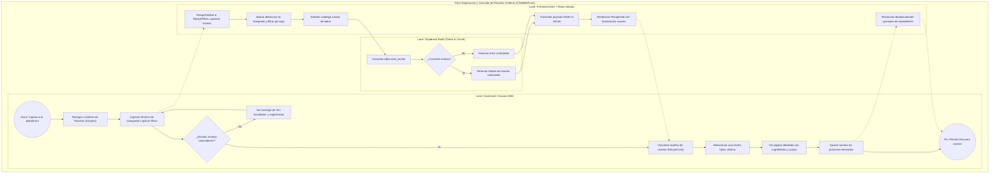
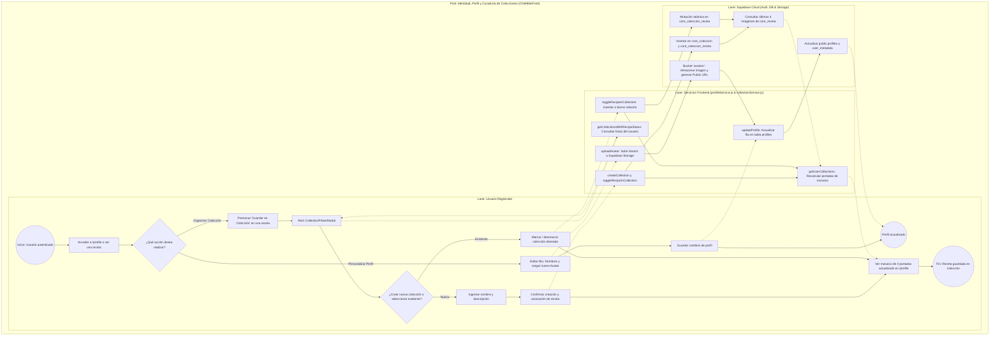
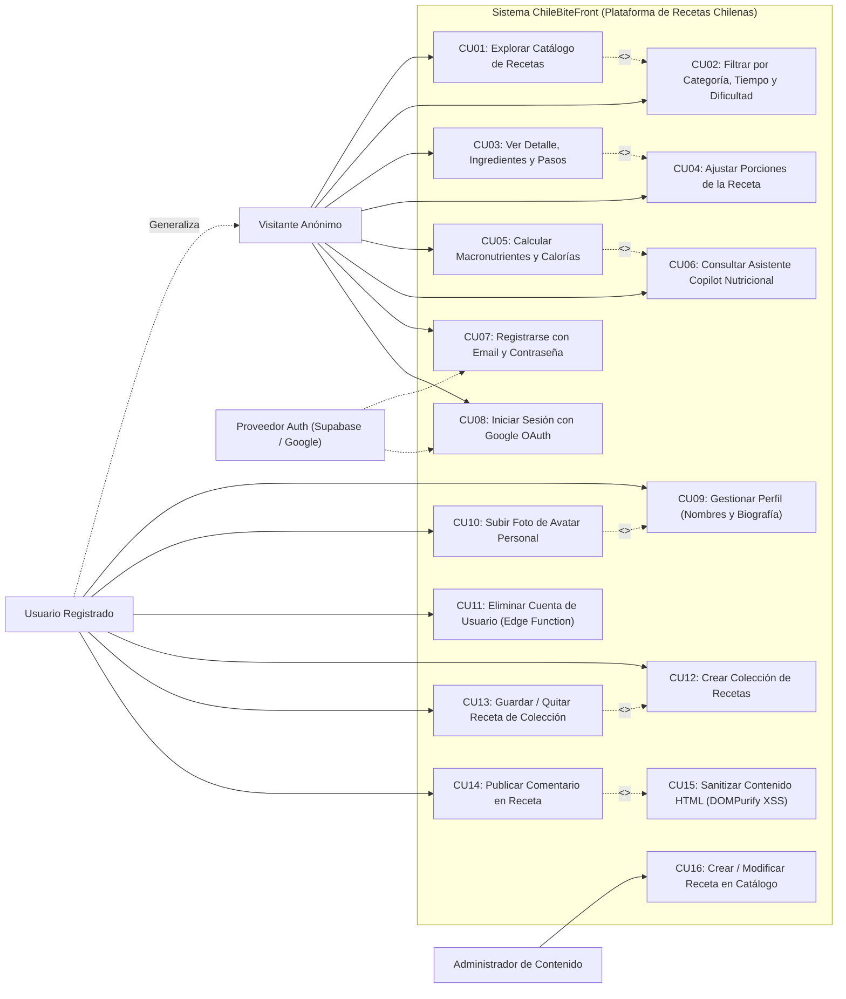
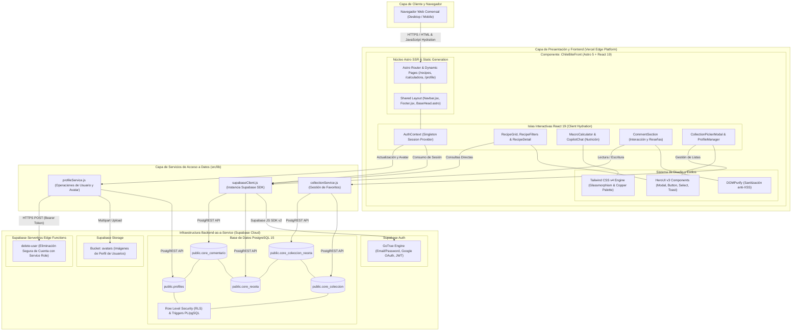
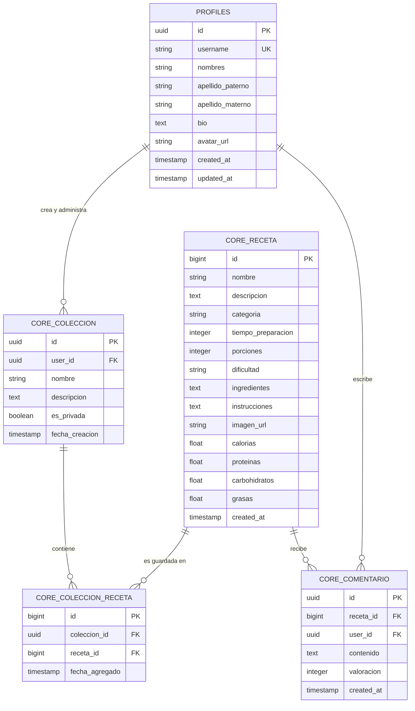

# 🍴 Documentación de Procesos de Negocio, Arquitectura y Modelo de Datos
## ChileBiteFront — Plataforma Web de Gastronomía Chilena

**Proyecto:** ChileBiteFront  
**Versión:** 2.0.0 (Enfocada exclusivamente en Recetario, Nutrición, Identidad y Colecciones)  
**Fecha:** 2026-10-10  

---

## 📑 Índice de Contenidos
1. [Paso 2.1: Detalle de los Procesos de Negocio (Diagramas BPMN)](#paso-21-detalle-de-los-procesos-de-negocio-diagramas-bpmn)
   - [Proceso 1: Búsqueda, Filtrado y Visualización Detallada de Recetas Chilenas](#proceso-1-búsqueda-filtrado-y-visualización-detallada-de-recetas-chilenas)
   - [Proceso 2: Planificación Nutricional y Calculadora de Macronutrientes](#proceso-2-planificación-nutricional-y-calculadora-de-macronutrientes)
   - [Proceso 3: Identidad, Gestión de Perfil y Curaduría de Colecciones Personales](#proceso-3-identidad-gestión-de-perfil-y-curaduría-de-colecciones-personales)
2. [Paso 2.2: Detalle de los Diagramas de Casos de Uso y Diagrama de Componentes](#paso-22-detalle-de-los-diagramas-de-casos-de-uso-y-diagrama-de-componente)
   - [Diagrama General de Casos de Uso (UML)](#diagrama-general-de-casos-de-uso)
   - [Especificación de Casos de Uso Críticos](#especificación-de-casos-de-uso-críticos)
   - [Diagrama de Componentes (Lógicos y Físicos)](#diagrama-de-componentes-lógicos-y-físicos)
3. [Paso 2.3: Detalle del Modelo de Datos](#paso-23-detalle-del-modelo-de-datos)
   - [Diagrama Entidad-Relación Lógico (ERD)](#diagrama-entidad-relación-lógico-erd)
   - [Anexo: Diccionario de Datos del Sistema](#anexo-diccionario-de-datos)
   - [Características Técnicas de la Base de Datos Seleccionada](#características-técnicas-de-la-base-de-datos-seleccionada)

---

# Paso 2.1: Detalle de los Procesos de Negocio (Diagramas BPMN)

Para este trabajo, el alcance se centra exclusivamente en el portal **ChileBiteFront**, modelando tres procesos neurálgicos con sus subprocesos, carriles (lanes) y puntos de decisión.

---

### Proceso 1: Búsqueda, Filtrado y Visualización Detallada de Recetas Chilenas

Modela el viaje del usuario para descubrir recetas del recetario chileno, filtrar por criterios de preparación y adaptar interactivamente los ingredientes según el número de comensales.

#### Descripción de Subprocesos del Proceso 1:
1. **Subproceso 1.1 (Filtrado y Búsqueda Multicriterio):** En [`RecipeFilters.jsx`](file:///c:/Users/chrys/Documents/Github/ChileBite/ChileBiteFront/Recetas/src/features/recipes/components/RecipeFilters.jsx), el usuario selecciona categorías (Pastel de Choclo, Cazuelas, Empanadas, etc.), dificultad o tiempo de cocción. El componente maneja un debounce de búsqueda para evitar peticiones superfluas.
2. **Subproceso 1.2 (Renderizado en Islas React):** La cuadrícula [`RecipeGrid.jsx`](file:///c:/Users/chrys/Documents/Github/ChileBite/ChileBiteFront/Recetas/src/features/recipes/components/RecipeGrid.jsx) se hidrata bajo la arquitectura de islas de Astro, manteniendo un tiempo de carga inicial ultrarrápido y aplicando estilos visuales Glassmorphism.
3. **Subproceso 1.3 (Adaptabilidad de Porciones):** En [`RecipeDetail.jsx`](file:///c:/Users/chrys/Documents/Github/ChileBite/ChileBiteFront/Recetas/src/features/recipes/components/RecipeDetail.jsx), al modificar el selector numérico de porciones, la función matemática de escala multiplica las cantidades de cada ingrediente en tiempo real sin recargar la página.

---

### Proceso 2: Cálculo Nutricional por Ingredientes y Asistente Chef IA

```mermaid
flowchart TD
    subgraph Pool_Calculadora ["Pool: Cálculo Nutricional y Asistente Chef IA (ChileBiteFront)"]
        
        subgraph Lane_Usuario ["Lane: Comensal / Usuario Web"]
            M1((Inicio: Ingreso a /calculadora)) --> M2{"¿Cómo desea armar su preparación?"}
            
            %% Flujo Manual
            M2 -- "Búsqueda Manual" --> M3["Escribir ingrediente en buscador (ej: pollo, arroz, palta)"]
            M3 --> M4["Seleccionar ingrediente sugerido del catálogo"]
            M4 --> M5["Definir cantidad y unidad: Gramos, Unidades, Cucharadas o Tazas"]
            M5 --> M6["Presionar 'Agregar' al plato"]
            M6 --> M7["Visualizar píldoras de macros acumuladas (Kcal, Proteínas, Carbs, Grasas)"]
            
            %% Flujo Asistente Chef IA
            M2 -- "Chef IA Copilot" --> M8["Abrir modal de Chef IA (CopilotChat)"]
            M8 --> M9["Escribir qué ingredientes tiene en el refrigerador o qué desea comer"]
            M9 --> M10["Recibir sugerencias de recetas saludables con pasos e ingredientes"]
            M10 --> M11{"¿Desea transferir la receta a la calculadora?"}
            M11 -- Sí --> M12["Pulsar 'Usar Receta' en la tarjeta sugerida"]
            M12 --> M13["Ver ingredientes cargados automáticamente en la calculadora"]
            M13 --> M7
            M11 -- No --> M14["Continuar conversando o cerrar chat"]
            M14 --> M7
            
            M7 --> M15{"¿Desea ajustar ingredientes?"}
            M15 -- Sí --> M16["Modificar cantidades o eliminar ingredientes del plato"]
            M16 --> M7
            M15 -- No --> M17((Fin: Información nutricional del plato obtenida))
        end

        subgraph Lane_CalculadoraEngine ["Lane: Calculadora de Macros (MacroCalculator.jsx)"]
            M3 -.-> C1["Búsqueda predictiva con normalize() en lista de ingredientes"]
            C1 -.-> M4
            M6 -.-> C2["Convertir unidad seleccionada a gramos base"]
            C2 --> C3["Calcular aporte proporcional de calorías, proteínas, carbohidratos y grasas"]
            C3 --> C4["Sumar al total acumulado y renderizar MacroPill reactivos"]
            C4 -.-> M7
            M12 -.-> C5["onClear(): Limpiar plato actual"]
            C5 --> C6["onSetRecipeName() y onSetRecipeSteps(): Asignar nombre y pasos"]
            C6 --> C7["Iterar ingredientes y agregarlos síncronamente al plato"]
            C7 -.-> M13
        end

        subgraph Lane_ChefIA ["Lane: Chef IA y Base de Datos (CopilotChat.jsx & Supabase)"]
            M9 -.-> I1["Enviar historial de conversación a /api/copilot"]
            I1 --> I2["Generar propuesta culinaria adaptada a los ingredientes disponibles"]
            I2 -.-> M10
            M12 -.-> I3["handleUseRecipe: Mapear ingredientes devueltos"]
            I3 --> I4["Consultar tabla core_ingrediente con ilike() y filtro stop-words"]
            I4 --> I5["Obtener datos nutricionales exactos de cada ingrediente coincidente"]
            I5 -.-> C7
        end

    end
```

#### Descripción de Subprocesos del Proceso 2:
1. **Subproceso 2.1 (Selección y Conversión de Ingredientes):** En [`MacroCalculator.jsx`](file:///c:/Users/chrys/Documents/Github/ChileBite/ChileBiteFront/Recetas/src/features/macros/MacroCalculator.jsx), el usuario busca alimentos en la base de datos `core_ingrediente` y selecciona la cantidad con el selector desplegable `CustomUnitSelect` (`g`, `unidad`, `cda` o `taza`). El motor convierte los valores a gramos base y actualiza las tarjetas `MacroPill`.
2. **Subproceso 2.2 (Consulta Contextual al Chef IA):** En [`CopilotChat.jsx`](file:///c:/Users/chrys/Documents/Github/ChileBite/ChileBiteFront/Recetas/src/features/macros/CopilotChat.jsx), el usuario indica qué alimentos tiene en el refrigerador o qué desea comer. El asistente genera recetas saludables con pasos detallados e ingredientes.
3. **Subproceso 2.3 (Transferencia Automática al Plato):** Al presionar "Usar Receta", el sistema ejecuta `handleUseRecipe`, busca automáticamente cada ingrediente en `core_ingrediente` (con filtrado inteligente de stop-words) e inyecta la receta en la calculadora con sus valores nutricionales calculados al instante.

---

### Proceso 3: Identidad, Gestión de Perfil y Curaduría de Colecciones Personales

Controla la autenticación, la actualización del perfil gastronómico del usuario y la organización de recetas en colecciones temáticas (Favoritos).

#### Descripción de Subprocesos del Proceso 3:
1. **Subproceso 3.1 (Actualización de Perfil y Almacenamiento):** [`profileService.js`](file:///c:/Users/chrys/Documents/Github/ChileBite/ChileBiteFront/Recetas/src/lib/profileService.js) actualiza simultáneamente `public.profiles` y sube la foto de avatar al bucket `avatars` con política `upsert: true`.
2. **Subproceso 3.2 (Gestión de Colecciones y Favoritos):** En [`collectionService.js`](file:///c:/Users/chrys/Documents/Github/ChileBite/ChileBiteFront/Recetas/src/lib/collectionService.js), la función `toggleRecipeInCollection` inserta o elimina vínculos en `core_coleccion_receta`.
3. **Subproceso 3.3 (Generación de Mosaicos):** `getUserCollections` recupera las últimas cuatro imágenes de recetas vinculadas para conformar dinámicamente un mosaico de vista previa en la tarjeta de la colección.

---

# Paso 2.2: Detalle de los Diagramas de Casos de Uso y Diagrama de Componente

### Diagrama General de Casos de Uso

---

### Especificación de Casos de Uso Críticos

#### CU04: Ajustar Dinámicamente las Porciones de una Receta
| Atributo | Detalle |
| :--- | :--- |
| **Identificador** | `CU04` |
| **Nombre** | Ajustar Porciones de la Receta |
| **Actores** | Visitante Anónimo / Usuario Registrado |
| **Precondiciones** | El usuario se encuentra en la vista detallada de una receta (`/recipes/[id]`). |
| **Flujo Principal** | 1. El usuario visualiza la lista de ingredientes basada en las porciones por defecto (ej. 4 personas). 2. El usuario interactúa con los controles `+` o `-` del selector de porciones en `RecipeDetail.jsx`. 3. El componente calcula el factor de escala: `factor = nuevasPorciones / porcionesBase`. 4. Se recalculan en memoria las cantidades de cada ingrediente (gramos, tazas, cucharadas). 5. La interfaz actualiza síncronamente la tabla de ingredientes sin recarga de página. |
| **Flujos Alternativos** | **2a. El usuario intenta ingresar un valor menor a 1 porción:** &nbsp;&nbsp;&nbsp;&nbsp;1. El sistema fija el límite mínimo en 1 y deshabilita el botón de restar. |
| **Postcondiciones** | Las cantidades mostradas corresponden exactamente al número de comensales seleccionado. |

---

#### CU05: Calcular Macronutrientes y Objetivos Calóricos
| Atributo | Detalle |
| :--- | :--- |
| **Identificador** | `CU05` |
| **Nombre** | Calcular Macronutrientes y Calorías |
| **Actores** | Visitante Anónimo / Usuario Registrado |
| **Precondiciones** | Ninguna (acceso público en `/calculadora`). |
| **Flujo Principal** | 1. El usuario ingresa edad, sexo biológico, estatura y peso actual. 2. Selecciona su nivel de actividad (desde Sedentario hasta Muy Activo). 3. Elige su objetivo corporal (Déficit, Mantenimiento, Superávit). 4. Pulsa el botón "Calcular Mis Macros". 5. `MacroCalculator.jsx` procesa la fórmula Mifflin-St Jeor y calcula el TDEE. 6. El sistema presenta el total de kcal diarias y la división en gramos de Proteínas, Carbohidratos y Grasas en gráficos visuales. |
| **Flujos Alternativos** | **1a. Datos biométricos incompletos o fuera de rango:** &nbsp;&nbsp;&nbsp;&nbsp;1. El sistema despliega alertas en los campos inválidos e impide el cálculo hasta su corrección. |
| **Postcondiciones** | El usuario obtiene su pauta nutricional y puede consultar al asistente Copilot para sugerencias de platos chilenos acordes. |

---

#### CU13: Guardar o Quitar Receta de una Colección
| Atributo | Detalle |
| :--- | :--- |
| **Identificador** | `CU13` |
| **Nombre** | Guardar o Quitar Receta de Colección (Favoritos) |
| **Actores** | Usuario Registrado |
| **Precondiciones** | Sesión de usuario activa provista por el Singleton `AuthContext`. |
| **Flujo Principal** | 1. El usuario pulsa el botón "Guardar" en una tarjeta de receta o en el detalle. 2. Se abre `CollectionPickerModal.jsx` mostrando las colecciones del usuario. 3. Cada colección muestra un checkbox indicando si la receta ya está guardada. 4. El usuario hace clic en una colección. 5. El sistema invoca `toggleRecipeInCollection` de `collectionService.js`. 6. Si no estaba guardada, se inserta la relación en `core_coleccion_receta`; si ya estaba, se elimina. 7. Se muestra un Toast de confirmación con HeroUI y se actualiza el mosaico de portadas. |
| **Flujos Alternativos** | **2a. El usuario no posee ninguna colección:** &nbsp;&nbsp;&nbsp;&nbsp;1. El modal presenta un campo para crear su primera colección (ej. "Favoritos"). &nbsp;&nbsp;&nbsp;&nbsp;2. Se crea en `core_coleccion` y se asocia la receta de inmediato. |
| **Postcondiciones** | La receta queda vinculada/desvinculada de la colección del usuario en Supabase. |

---

#### CU14: Publicar Comentario con Sanitización XSS
| Atributo | Detalle |
| :--- | :--- |
| **Identificador** | `CU14` |
| **Nombre** | Publicar Comentario en Receta |
| **Actores** | Usuario Registrado |
| **Precondiciones** | Sesión activa de usuario y receta cargada en pantalla. |
| **Flujo Principal** | 1. El usuario navega a la sección de comentarios de la receta (`CommentSection.jsx`). 2. Redacta su opinión culinaria y selecciona una valoración con estrellas (1 a 5). 3. Pulsa "Publicar Comentario". 4. El sistema ejecuta `DOMPurify.sanitize(texto)` para eliminar etiquetas HTML o scripts maliciosos. 5. Se inserta el comentario en la tabla `core_comentario` de Supabase. 6. El comentario se añade de forma reactiva a la lista visible y se emite un Toast de éxito. |
| **Flujos Alternativos** | **2a. El texto está vacío o excede el límite de caracteres:** &nbsp;&nbsp;&nbsp;&nbsp;1. El botón de envío se mantiene deshabilitado. |
| **Postcondiciones** | El comentario limpio y validado se persiste en la base de datos y es visible para todos los usuarios. |

---

### Diagrama de Componentes (Lógicos y Físicos)

---

# Paso 2.3: Detalle del Modelo de Datos

### Diagrama Entidad-Relación Lógico (ERD)

---

### Anexo: Diccionario de Datos

#### 1. Tabla: `profiles`
*Almacena la información de perfil público y biografía de los usuarios.*
| Campo | Tipo | Nulo | Clave | Default | Descripción |
| :--- | :--- | :---: | :---: | :---: | :--- |
| `id` | `UUID` | No | PK, FK | `auth.uid()` | Identificador referenciado a `auth.users.id`. |
| `username` | `VARCHAR(50)` | No | UK | - | Nombre de usuario único en la plataforma. |
| `nombres` | `VARCHAR(100)` | Sí | - | `NULL` | Nombres del usuario. |
| `apellido_paterno` | `VARCHAR(100)` | Sí | - | `NULL` | Primer apellido. |
| `apellido_materno` | `VARCHAR(100)` | Sí | - | `NULL` | Segundo apellido. |
| `bio` | `TEXT` | Sí | - | `NULL` | Biografía o reseña culinaria del usuario. |
| `avatar_url` | `TEXT` | Sí | - | `NULL` | URL pública de la imagen en Supabase Storage (`avatars`). |
| `created_at` | `TIMESTAMPTZ` | No | - | `NOW()` | Fecha y hora de creación de la cuenta. |
| `updated_at` | `TIMESTAMPTZ` | No | - | `NOW()` | Fecha de última modificación del perfil. |

---

#### 2. Tabla: `core_receta`
*Catálogo maestro de recetas típicas chilenas con valores nutricionales calculados.*
| Campo | Tipo | Nulo | Clave | Default | Descripción |
| :--- | :--- | :---: | :---: | :---: | :--- |
| `id` | `BIGINT` | No | PK | `AUTOINCREMENT` | Identificador único de la receta. |
| `nombre` | `VARCHAR(200)` | No | - | - | Nombre del plato tradicional (ej. Pastel de Choclo). |
| `descripcion` | `TEXT` | Sí | - | `NULL` | Reseña cultural o gastronómica del plato. |
| `categoria` | `VARCHAR(50)` | No | - | `'Tradicional'` | Categoría culinaria (Guisos, Sopas, Empanadas, Postres). |
| `tiempo_preparacion` | `INTEGER` | No | - | `30` | Tiempo estimado de cocción y elaboración en minutos. |
| `porciones` | `INTEGER` | No | - | `4` | Raciones base de la receta. |
| `dificultad` | `VARCHAR(20)` | No | - | `'Media'` | Nivel de dificultad (Fácil, Media, Difícil). |
| `ingredientes` | `TEXT` | No | - | - | Lista de ingredientes formateada. |
| `instrucciones` | `TEXT` | No | - | - | Procedimiento de preparación paso a paso. |
| `imagen_url` | `TEXT` | Sí | - | `NULL` | Fotografía de alta calidad del plato. |
| `calorias` | `NUMERIC(6,2)` | Sí | - | `0.0` | Calorías por porción estándar (kcal). |
| `proteinas` | `NUMERIC(6,2)` | Sí | - | `0.0` | Proteínas en gramos por porción. |
| `carbohidratos` | `NUMERIC(6,2)` | Sí | - | `0.0` | Carbohidratos en gramos por porción. |
| `grasas` | `NUMERIC(6,2)` | Sí | - | `0.0` | Grasas totales en gramos por porción. |
| `created_at` | `TIMESTAMPTZ` | No | - | `NOW()` | Fecha de registro en el recetario. |

---

#### 3. Tablas: `core_coleccion` y `core_coleccion_receta`
*Permiten a los usuarios crear carpetas temáticas y coleccionar recetas favoritas.*
* **`core_coleccion`**:
| Campo | Tipo | Nulo | Clave | Default | Descripción |
| :--- | :--- | :---: | :---: | :---: | :--- |
| `id` | `UUID` | No | PK | `gen_random_uuid()` | Identificador único de la colección. |
| `user_id` | `UUID` | No | FK | - | Usuario propietario referenciado a `profiles.id`. |
| `nombre` | `VARCHAR(100)` | No | - | - | Nombre de la colección (ej. "Almuerzos de Domingo"). |
| `descripcion` | `TEXT` | Sí | - | `''` | Descripción opcional de la colección. |
| `es_privada` | `BOOLEAN` | No | - | `TRUE` | Visibilidad de la colección. |
| `fecha_creacion` | `TIMESTAMPTZ` | No | - | `NOW()` | Fecha de creación de la carpeta. |

* **`core_coleccion_receta`**:
| Campo | Tipo | Nulo | Clave | Default | Descripción |
| :--- | :--- | :---: | :---: | :---: | :--- |
| `id` | `BIGINT` | No | PK | `AUTOINCREMENT` | Identificador de la relación. |
| `coleccion_id` | `UUID` | No | FK | - | Colección contenedora (`ON DELETE CASCADE`). |
| `receta_id` | `BIGINT` | No | FK | - | Receta guardada (`ON DELETE CASCADE`). |
| `fecha_agregado` | `TIMESTAMPTZ` | No | - | `NOW()` | Fecha de guardado en la colección. |

---

#### 4. Tabla: `core_comentario`
*Comentarios, valoraciones y reseñas de comensales en cada receta.*
| Campo | Tipo | Nulo | Clave | Default | Descripción |
| :--- | :--- | :---: | :---: | :---: | :--- |
| `id` | `UUID` | No | PK | `gen_random_uuid()` | Identificador único del comentario. |
| `receta_id` | `BIGINT` | No | FK | - | Receta comentada referenciada a `core_receta.id`. |
| `user_id` | `UUID` | No | FK | - | Usuario autor referenciado a `profiles.id`. |
| `contenido` | `TEXT` | No | - | - | Comentario sanitizado contra ataques XSS (DOMPurify). |
| `valoracion` | `INTEGER` | No | - | `5` | Calificación con estrellas (1 a 5). |
| `created_at` | `TIMESTAMPTZ` | No | - | `NOW()` | Fecha y hora de publicación. |

---

### Características Técnicas de la Base de Datos Seleccionada

* **Motor:** PostgreSQL versión 15 (mediante la infraestructura BaaS de **Supabase Cloud**).
* **Seguridad a Nivel de Filas (Row Level Security - RLS):**
  * Políticas RLS en `core_coleccion` impiden que otros usuarios vean o modifiquen colecciones privadas ajenas (`auth.uid() = user_id`).
  * En `profiles`, las políticas permiten lectura pública de avatares/biografías, pero restringen la mutación (`UPDATE`) únicamente al propio dueño de la sesión.
* **Integración con Storage:**
  * El bucket `avatars` se conecta directamente con los perfiles, manejando compresión y distribución CDN global.
* **Disparadores PL/pgSQL:**
  * Un trigger de autenticación en PostgreSQL (`on_auth_user_created`) crea automáticamente la tupla correspondiente en `public.profiles` al registrarse un nuevo usuario, garantizando consistencia referencial sin lógica redundante en el frontend.
